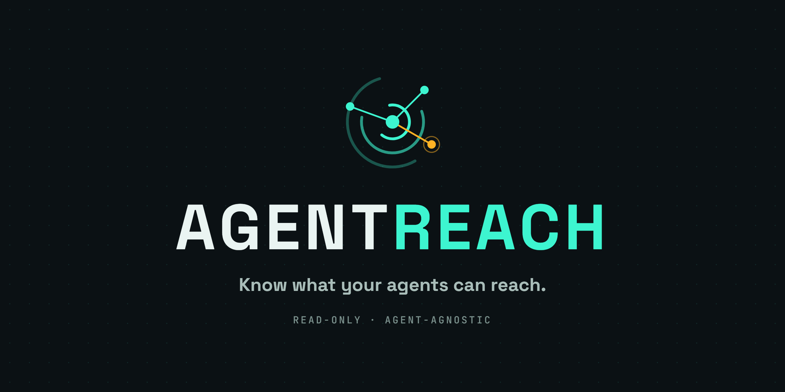
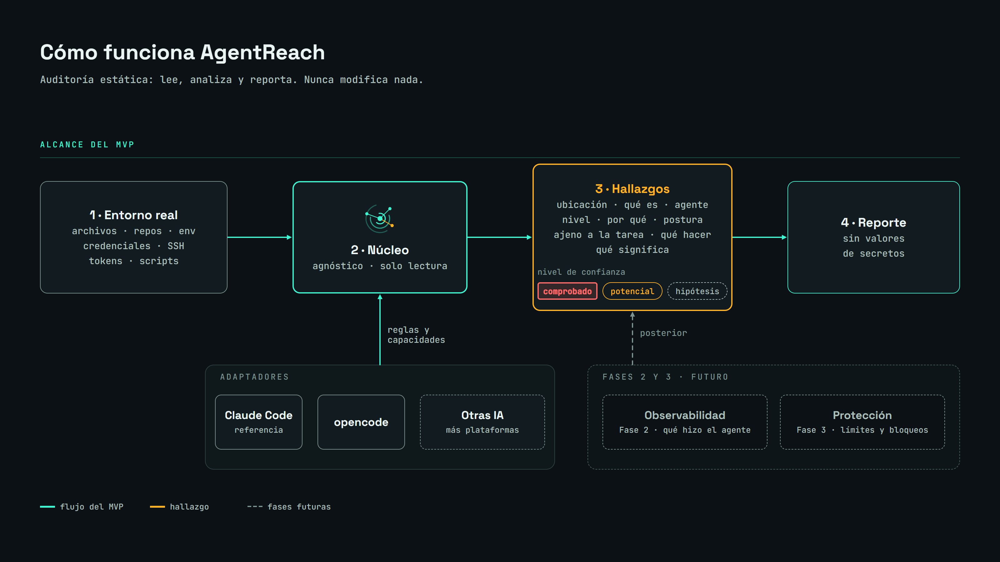
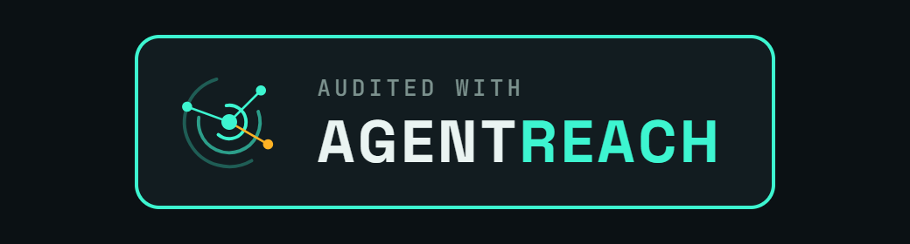

<p align="center">
  
</p>

<h3 align="center">Know what your agents can reach.</h3>

<p align="center">
  An open-source tool that works with any AI agent. It shows <strong>what an AI agent can access in your environment</strong>. Each result has evidence and a confidence level.
</p>

<p align="center">
  
  
  
  
  
</p>

<p align="center">
  <a href="#what-it-is-and-why-it-exists">What it is</a> ·
  <a href="#architecture">Architecture</a> ·
  <a href="#roadmap">Roadmap</a> ·
  <a href="#security-rules">Security</a> ·
  <a href="#contributing">Contributing</a>
</p>

> [!WARNING]
> **AgentReach is a working MVP and it is in testing.** You can install it with one command, without downloading the repository (see [Installation](#installation)), and use it on a project folder. It is not on PyPI yet, and it is being tried on real projects with different agents. Anything that does not exist yet is marked as *planned*.

---

## Table of contents

- [What it is and why it exists](#what-it-is-and-why-it-exists)
- [The problem](#the-problem)
- [What makes it different](#what-makes-it-different)
- [Features](#features)
- [Confidence levels](#confidence-levels)
- [Glossary: words worth knowing](#glossary-words-worth-knowing)
- [What a report looks like](#what-a-report-looks-like)
- [Installation](#installation)
- [Technology](#technology)
- [Architecture](#architecture)
- [Roadmap](#roadmap)
- [Security rules](#security-rules)
- [Project documentation](#project-documentation)
- [Contributing](#contributing)
- [License](#license)
- [Credits](#credits)

---

## What it is and why it exists

An AI agent that works in your repository acts with **the permissions of the person who runs it**. AgentReach answers one clear question:

> **What does your environment allow this agent to do, and how sure are we?**

AgentReach analyzes the real environment where the agent runs. It checks files, repositories, the names of environment variables, credentials, the location of SSH keys, scripts, and the settings of your agents. It then produces a list of **findings**. A finding is one item the agent could access. Each finding has evidence, a location, and a confidence level. **AgentReach never prints the value of a secret and never changes what it analyzes.**

The long-term vision has three parts: **know** what an agent can access, **control** what it can do, and **understand** what it really did. The MVP covers only the first part. It checks and warns.

## The problem

An instruction like *"work only in `src/`"* does not limit what the agent can access. From where it works, the agent can access credentials, SSH keys, tokens, deploy scripts, or malicious instructions hidden in context files (`README.md`, `CLAUDE.md`, `AGENTS.md`).

When an agent can access **more than its task needs**, there is a risk, even if nothing bad ever happens. AgentReach wants to make this difference visible before something goes wrong.

## What makes it different

Existing community tools mostly check the **declared configuration**. This means what is written in the settings: `allow` rules, MCP servers (connections between the agent and external tools), and secrets in configuration files.

AgentReach aims to measure the **difference between what is declared and what the agent can really access**. It takes into account operating system permissions, mounted folders, symbolic links and *junctions* (folder links on Windows; see the glossary), environment variables, and available tools.

| | Declared configuration | Real access (AgentReach goal) |
|---|---|---|
| Question | What does the configuration say the agent can do? | What can the agent really access? |
| Considers operating system permissions, mounted folders, and symlinks | Not necessarily | Yes, this is the focus |
| Tells you how sure it is about each finding | Rarely | Always (verified / potential / hypothesis) |

> [!NOTE]
> We have **not yet checked** whether another tool already measures this difference in the same way. This is a design hypothesis, not a proven claim.

## Features

Items marked **Built** work today. Items marked **Planned** are not available yet.

- **Built: it asks permission first.** AgentReach is a terminal tool operated by a person. It shows what it does and asks (`S`/`N`) before it reads the folder.
- **Built: read-only static audit** of the project folder.
- **Built: credentials and tokens** found in files that an agent can access. The values are never shown.
- **Built: links that leave the project** (symlinks and junctions). They are reported and never followed.
- **Built: environment variables, by name only.**
- **Built: sensitive user locations** (`~/.aws`, `~/.ssh`, `~/.npmrc`) are **opt-in**. Only metadata is read, never content.
- **Built: Git settings read as plain text**, without running Git: remotes with credentials, hooks, and settings that can start a program.
- **Built: context files, deploy scripts, and hidden text.** Instruction files (`CLAUDE.md`, `AGENTS.md`), including ones outside the project, deploy scripts, and invisible Unicode characters.
- **Built: project settings that run by themselves**, such as hooks, command-based MCP servers (connections to external tools), permission bypass, and tasks that start when a folder is opened.
- **Built: which agents are configured.** It recognizes 22 agents and frameworks (Claude Code, opencode, Gemini CLI, Codex, GitHub Copilot, Cursor, Windsurf, Kiro, and more). It says *configured*, not *used*: a folder alone cannot prove which agent did the work. A weak sign never identifies an agent, and "could not determine" is a valid answer.
- **Built: deep analysis for Claude Code and opencode** (versions 1.x and 2.x): their permission rules, per-agent rules, and personal agents.
- **Built: real confidence levels** (verified, potential, hypothesis) for each agent, with a second independent permission check. When a level is "potential" because something could not be understood, the report says which file and which key.
- **Built: "unrelated to the task"**, from the README of the project or the `--tarea` option ("task" in Spanish).
- **Built: a short summary in the terminal and a visual HTML report** (route, list, table, and print views; English and Spanish; light and dark theme; JSON and CSV export).
- **Built: `agentreach doctor`**, a read-only check of your computer.
- **Planned: deep analysis for more agents.** Today the other agents are recognized, not analyzed.
- **Planned: beyond the folder.** Following MCP connections and links, and what they connect to.
- **Planned: a per-project policy** that the team can share.
- **Planned: Linux and macOS.** It has been tested on Windows only.
- **Planned: observability and protection** (phases 2 and 3).

## Confidence levels

Each finding says how sure it is. AgentReach does not claim that the agent can access something only because a text mentions it.

| Level | Meaning |
|---|---|
| **Verified** | Three things are true at the same time. The file exists. The system permissions allow the person who runs the agent to read it. No rule of the agent blocks it. The permission is worked out from the data the system keeps about who can read the file, without opening it to test it. |
| **Potential** | The item exists and the agent might access it, but one of the three things could not be confirmed. For example, the permission could not be determined. Another example is a rule of the agent that forbids access, but that rule is not a real barrier in the system. |
| **Hypothesis** | A weak or indirect sign that you should check manually. |

> [!NOTE]
> These definitions are the basis of the design. The exact special cases will be refined in the PRD (product requirements document). They will be tested with a test project before the MVP is published.

### Reach routes

A finding is not just a point: it is a **route**. The report shows each reach route as a chain:

**Agent → Where → What is there → Possible effect**

For example: *an agent → `config/deploy.env`, line 3 → a cloud token → it could give access to a deployment account*. A solid line means AgentReach checked that step. A dashed line means it did **not** check it (AgentReach never tests what a key can do, or whether it is valid). Several findings can share a step, so you can see many routes that end in the same place.

The level of a route tells you how far AgentReach could confirm it:

- **Verified**: the agent can reach it today, and AgentReach confirmed the three facts above.
- **Potential**: it probably can, but something could not be confirmed. The report always says what.
- **Hypothesis**: only a weak sign. Check it by hand.

If your own agent settings contain something AgentReach does not understand (for example a hook that can block reads), AgentReach does not guess: it lowers the level to Potential and says so.

## Glossary: words worth knowing

| Word | What it means, in simple terms |
|---|---|
| **MVP** | "Minimum viable product": the first version that is already useful, even if it lacks some features. Here, the first version only **checks and warns**. It does not block anything. |
| **In testing** | The MVP is built. It is being tried on real projects with different agents before the package is published. |
| **AI agent** | A program with artificial intelligence (such as Claude Code or opencode) that can read files and run commands on your computer on your behalf. |
| **Access** | Everything the agent could read or use from where it works, not only what you asked it to do. |
| **Finding** | One item that AgentReach shows in the report, for example a token or an SSH key that the agent could access. It comes with evidence and a confidence level. |
| **Repository** | The folder of a project, together with the history of its changes. |
| **Symlink (symbolic link)** | A shortcut made by the operating system. A folder or file that points to another location. If your project has one that points to `C:\Users\you\.ssh`, the agent can get there even though it looks like part of the project. |
| **Junction** | The same idea as a symlink, but for folders on Windows. It can be created without administrator rights, so it is a risk. |
| **Permissions / ACL** | The list that says who can read, write, or run each file. ACL (access control list) is the name of this list on Windows. |
| **Environment variable** | A value stored in your session (for example, an access key). Every program you run can see it, including the agent. |
| **Token / credential** | A key or password that gives access to a service (the cloud, GitHub, a database). |
| **SSH key** | A file that identifies you to servers and GitHub. Whoever has it can pretend to be you. |
| **Sandbox** | An isolated environment that limits what a program can see. Claude Code does not offer it on native Windows (without WSL2, the Linux layer for Windows). |
| **Core** | The main part of AgentReach. It analyzes the environment and does not depend on any single agent. |
| **Adapter** | The piece that understands the configuration of one specific agent (Claude Code, opencode, and others). Because of it, the core does not depend on any single agent. |
| **Opt-in** | Something that is off until you choose to turn it on. |

## What a report looks like

AgentReach shows a **short summary in the terminal** and creates a **visual report** that you open in your browser. The summary looks like this (the file names are invented):

```text
REVIEW FINISHED   ·   Claude Code (configured)

  ■ Verified            5      confirmed exposure
  ▲ Potential          12      probable, something is not confirmed
  ◊ Hypothesis          1      only a suggestion
  ○ Could not review    4      gaps in coverage

Most urgent (3 of 5):
  ■ .env · line 2                Credential in a file (payments service)
  ■ config/deploy.env · line 5   Credential in a file (cloud)
  ■ docs/notes.txt · line 27     Platform or deployment secret

This is a summary. The full detail is in the visual report.

Visual report created: <your home folder>\AgentReach-reportes\report-my-project-<date>.html
Open the report in the browser? (S/N):
```

Each finding in the visual report has the same eight fields: where it is and the line, what it is and whose it is, level and why, unrelated to the task, platform and agent, agent rules, what to do, and what it means. It also has a fixed section with what AgentReach **could not check**. A level of "potential" always says why it is not "verified".

You can try the design without running anything: open the [report sketch](https://github.com/Alexmedina-Dev/AgentReach/blob/development/docs/boceto-reporte/reporte-final/reporte-final.html) in a browser (it is in the `development` branch). It uses invented data.

## Installation

> [!NOTE]
> **You do not need to download or clone this repository to use AgentReach.** You install the tool with one command, from a single small file (a *wheel*) attached to each [release](https://github.com/Alexmedina-Dev/AgentReach/releases). The package is not on PyPI yet, so `uv tool install agentreach` does not work today.

### Install on any computer (Windows, PowerShell)

**1. Check if `uv` is installed.** `uv` is the tool that installs AgentReach and brings the Python it needs (3.12 or newer). You do not install Python yourself.

```powershell
uv --version
```

If it prints a version (for example `uv 0.8.0`), go to step 3. If it says the command is not recognized, go to step 2.

**2. Install `uv`:**

```powershell
powershell -ExecutionPolicy ByPass -c "irm https://astral.sh/uv/install.ps1 | iex"
```

Close the terminal, open a new one and run `uv --version` again to check it.

**3. Install AgentReach from the release:**

```powershell
uv tool install https://github.com/Alexmedina-Dev/AgentReach/releases/download/v0.1.0-dev0/agentreach-0.1.0.dev0-py3-none-any.whl
uv tool update-shell     # one time only: lets your terminal find the command
```

**4. Close the terminal and open a new one**, then check it:

```powershell
agentreach --version
```

To update, run the install command of the new release and add `--reinstall`. AgentReach never updates itself and never uses the network during a review.

If the computer has no internet access, download the `.whl` file from the release on another computer, copy it over (USB drive or shared folder) and install it from the path: `uv tool install C:\Users\you\Downloads\agentreach-0.1.0.dev0-py3-none-any.whl`.

### Run it from the source code (developers and contributors)

Only people who want to change the code need the repository. Pull Requests go to the `development` branch (see [`CONTRIBUTING.md`](CONTRIBUTING.md)).

```bash
git clone https://github.com/Alexmedina-Dev/AgentReach.git
cd AgentReach
uv run agentreach <folder>        # example: uv run agentreach .
uv build --wheel                  # builds the file used in the steps above
```

If the terminal says it does not know the command, you skipped `uv tool update-shell` or you did not open a new terminal. After that, the use is always the same:

1. Open a terminal (Windows Terminal, VS Code, or the one you use).
2. Go into the project folder you want to review.
3. Type `agentreach`. It shows what it is and what it does, and asks if it may read the folder (`S`/`N`).
4. If you answer `S`, it reviews the folder and shows a short summary. If you answer `N`, it reads nothing and exits.
5. At the end it tells you where the visual report is and asks if you want to open it in the browser.

The tool only reads your project. It changes nothing in it, does not use the network, does not run your project's programs and does not show secret values. It only saves the report outside the reviewed folder, and only opens the browser with your permission.

AgentReach is a terminal tool operated by a person: without an interactive terminal it reads nothing, and there is no flag that answers for you. It shows what it is and what it does, then asks two separate permissions: to read the folder, and to see the rules of your agents outside the project (user and managed configuration; only the rules, never the values; with N nothing outside the project is read and the levels that depend on the rules stay at "potential"). The first one: it asks permission to read the folder (only `s`/`S` or `n`/`N` count; Enter alone does not decide; three invalid answers and it exits without reading). Without a folder (`uv run agentreach`) it reviews the current folder. It prints a short summary by level with the three most urgent findings; `--detalle` prints the full list.
When it finishes it also saves an HTML report in `AgentReach-reportes` inside your home folder (never inside the reviewed folder),
tells you where it is, and asks once whether to open it in the browser (`--abrir` / `--no-abrir` skip the question; `--sin-reporte-html`
turns the report off). Those are the only things it writes besides `--salida`, and the browser is the only program it asks the system to open.

Planned, not available yet:

```bash
# COMING SOON: illustrative, not runnable yet
uv tool install agentreach        # global installation (planned)
```

Per-project installation (a policy that belongs to the repository) is also planned. The exact commands will be documented when the package is published.

## Technology

AgentReach is a command-line program. It has no web page and no background service. The choices below are made on purpose to keep the tool small, safe, and easy to check.

| Part | Choice | Why |
|---|---|---|
| Language | **Python 3.12 or newer** | Easy to read, and it runs on Windows, Linux, and macOS. |
| Libraries | **Only the Python standard library** (no outside packages at runtime) | A security tool should not depend on code from third parties. Fewer dependencies means less risk. |
| Project and install tool | [`uv`](https://docs.astral.sh/uv/) with the `uv_build` build system | One fast tool to install, run, and build the project. |
| Tests | `pytest` | Includes tests for the safety rules: read-only, no network, and no secret values in reports. |
| Code style check | `ruff` | Keeps the code clean and consistent. |
| Design | **Hexagonal architecture**: an independent core plus one adapter for each agent | A new agent can be added without changing the core. |
| Platform | Windows (tested) | Linux and macOS come after the tests on real projects. |
| Report | A short text summary in the terminal, and **a static HTML5 and CSS3 file** that opens in your browser | Clear and consistent to read. It needs no server and no network, so it keeps the "no network" rule. |
| History (planned, phase 2) | SQLite (a database in one file, included with Python) | No database server to install or maintain. |

> [!NOTE]
> The test and style tools are only for developers. They are not needed to run AgentReach.

### The HTML report

The goal is a report that anyone can understand at first sight, not just a long list of text. What it has:

- **A summary at the top:** how many findings there are, grouped by confidence level (verified, potential, hypothesis), so you see the most serious ones first.
- **One card for each finding**, with the same 8 fields every time: location and line, what it is and whose it is, level and why, unrelated to the task, platform and agent, agent rules, what to do, and what it means. The wording is simple and avoids jargon.
- **Filters and search** by level, agent, or type of finding, using only the browser. No server is involved.
- **Clear colors and icons** that always mean the same thing, and that also work for people who cannot tell colors apart.
- **No secret values, ever.** Only the location, the type, and the level.
- **Works offline,** is a single file you can save or share, and is available in English and Spanish.

AgentReach writes this file for you, outside the reviewed folder. It never sends it anywhere.

## Architecture

A **core that works with any agent** analyzes the real environment. It produces findings in one common format. The **adapters** read the configuration of each agent. They also state clearly how much real control each platform offers.

<p align="center">
  
</p>

<sub>Editable source of the diagram: <code>docs/diagrama/Diagram.dc.html</code>. To regenerate the image: <code>uv run --no-project --with playwright python docs/diagrama/exportar.py</code>.</sub>

Each adapter declares one of these real capabilities:

| Adapter capability | What it means |
|---|---|
| Audit only | It reports findings. The platform offers nothing more. |
| Audit and warn | It reports and warns about the risks it finds (this is what the MVP covers). |
| Audit and block | It blocks actions, but only where the platform allows it (phase 3). |

It must be possible to add the observability and protection layers **without rewriting the core**.

## Roadmap

| Phase | What it includes | Status |
|---|---|---|
| **1: MVP** | Static audit and warnings. Deep analysis for Claude Code and opencode, and recognition of 22 agents. | Built (25 user stories done) and in testing with real agents. Next: tests with several agents and publication |
| **2: Observability** | History of actions, and detection of actions that are unrelated to the task. | Later |
| **3: Protection** | Policies you can configure, and blocking where the platform allows it. | Later |

**The MVP does not include** blocking of actions, prevention while the agent works, live monitoring, or audit of cloud identities.

> [!NOTE]
> **Honesty rule:** the MVP checks and warns. It does not promise prevention. That will come later, platform by platform, and only where the platform allows it.

## Security rules

These design rules are not negotiable.

- **Read-only.** AgentReach never changes the repository or the environment it analyzes. It only warns about what it finds.
- **No secret values.** Reports show the location, the type, and the confidence level. They never show the value.
- **No network.** It does not send private information to external servers, and the visual report works offline.
- **Permission first.** It asks before it reads a folder. No option answers for you, and without an interactive terminal it reads nothing.
- **It writes only the report.** The report goes outside the reviewed folder, and the browser opens only with your permission.
- **Sensitive user locations** (`~/.aws`, `~/.ssh`, `~/.npmrc`) are **opt-in**. They are off by default. They read metadata only (existence and permissions), never content.
- **No overstating.** A mention does not prove that the agent can access something. AgentReach considers operating system permissions, mounted folders, symlinks and junctions, environment variables, available commands, and the limits of the sandbox.

To report a vulnerability, read [`SECURITY.md`](SECURITY.md) and use **Security → Report a vulnerability**. Do not open a public issue (a public thread on GitHub).

## Project documentation

- [`docs/vocabulario-es-en.md`](docs/vocabulario-es-en.md): Spanish and English vocabulary of the project.
- [`docs/diagrama/`](docs/diagrama/): editable source of the architecture diagram.
- Design sketches of the visual report are in the [`development` branch](https://github.com/Alexmedina-Dev/AgentReach/tree/development/docs/boceto-reporte).

## Contributing

The project is in testing. There is a basic [`CONTRIBUTING.md`](CONTRIBUTING.md). The most useful contributions today are **ideas, design review, and test cases** (for example, well-documented patterns of exposure). Before you propose big changes, open an issue (a discussion thread on GitHub) to talk about them.

The project will document how to add a new adapter without changing the core. This is one of the success criteria of the project.

## License

Distributed under the **Apache License 2.0**. See [`LICENSE`](LICENSE).

## Credits

Created by **Alex Medina** ([@Alexmedina-Dev](https://github.com/Alexmedina-Dev)). The planning follows the [BMAD](https://github.com/bmad-code-org/bmad-method) method. The work is supported by AI agents, which are exactly the kind of tool that AgentReach wants to audit.

<p align="center">
  <br>
  <sub>Brand badge "Audited with AgentReach". It does not represent any real audit yet: the tool does not exist yet.</sub>
</p>
