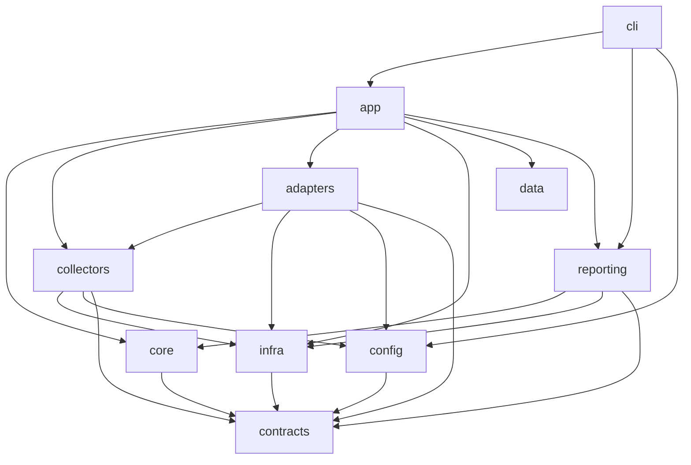
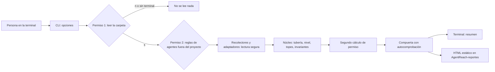

# Architecture Spine — AgentReach

## Cómo leer este documento

AgentReach es una herramienta de terminal, escrita en Python, que **audita en solo lectura a qué podría acceder un agente de IA** dentro de una carpeta de trabajo. Este documento fija las decisiones que, si cada quien las tomara por su lado, harían derivar el proyecto. No repite el diseño visual ni el comportamiento de pantalla: eso vive en los dos contratos de experiencia de usuario (`DESIGN.md` y `EXPERIENCE.md`), que este texto solo referencia.

Cada decisión lleva un identificador estable `AD-n` (de «decisión de arquitectura»). Los números **nunca se renumeran**: `AD-1` a `AD-10` vienen del borrador del 2026-11-06 y se corrigieron en su lugar; `AD-11` en adelante son decisiones nuevas, nacidas al construir el producto. La etiqueta **[ADOPTED]** (adoptada) significa que la decisión ya estaba tomada y está construida; **[CAMBIÓ]** significa que el borrador decía otra cosa y el código mostró lo contrario o algo mejor. Cada decisión se escribe con tres claves, que se mantienen en inglés por el formato: **Binds** = a qué se aplica; **Prevents** = qué desvío evita; **Rule** = la regla que hay que cumplir.

Glosario mínimo (más términos se explican donde aparecen):

| Término | Qué significa aquí |
| --- | --- |
| Hallazgo (`Finding`) | Un dato estructurado que dice «en esta ubicación hay algo de este tipo, con este nivel de confianza». Nunca contiene el valor de un secreto. |
| Nivel de confianza | Cuánta certeza hay de que el agente llega a eso: **comprobado**, **potencial** o **hipótesis**. |
| Puerto / adaptador | Un puerto es un «enchufe» que el núcleo define (por ejemplo, «leer archivos sin escribir»). Un adaptador es la pieza que se conecta a él (por ejemplo, el lector real del disco o el de una plataforma como Claude Code). |
| Compuerta | El único paso por el que un hallazgo pasa antes de convertirse en texto o HTML: copia solo los campos permitidos. |
| ACL | Lista de control de acceso: la tabla con la que Windows decide quién puede leer, escribir o ejecutar un archivo. |
| `ctypes` | Parte de la biblioteca estándar de Python que permite llamar funciones del propio Windows sin instalar nada extra. |
| Esquema | La descripción exacta de los campos que debe tener un dato, para poder comprobarlo. |
| JSON | Formato de texto para datos (pares nombre y valor) que leen tanto personas como programas. |
| Oráculo | La lista de respuestas correctas hecha a mano sobre un proyecto de prueba, contra la que se mide a AgentReach. |
| Canario | Un secreto falso con marca única que se siembra en las pruebas para comprobar que nunca aparece en ninguna salida. |
| CLI | La interfaz de línea de comandos: el programa `agentreach` que se usa en la terminal. |

## Design Paradigm

**Hexagonal más tubería de filtros.** «Hexagonal» (también llamada «puertos y adaptadores») significa que el centro del programa, el **núcleo**, solo conoce reglas del negocio y define puertos; todo lo que toca el mundo exterior (disco, entorno, Windows, la pantalla, cada agente) entra por adaptadores que se pueden cambiar sin tocar el núcleo. «Tubería de filtros» significa que la auditoría es una secuencia de etapas pequeñas: recolectar evidencia, evaluar el nivel, pasar por la compuerta y dibujar. La dirección de las dependencias es una regla, no una sugerencia: el núcleo no importa nada de afuera.

Mapa de capas a carpetas reales (todas bajo `src/agentreach/`; los nombres de módulos están en español):

| Capa | Carpeta | Qué hay |
| --- | --- | --- |
| Contratos | `contracts/` | `Finding`, motivos de «no se pudo revisar», puertos (`ReadOnlyFs`, `EnvView`, `FsProbe`, `Detector`, `AgentAdapter`, `Narrator`), reglas de rutas. Lo único que los adaptadores deben conocer. |
| Núcleo | `core/` | Tubería, evaluador, cálculo del nivel, política de topes, invariantes, relación con la tarea, verificación independiente, autocomprobación, catálogos de explicaciones y de términos. |
| Recolectores | `collectors/` | Cada uno produce candidatos de hallazgo y no juzga el nivel: archivos del repositorio, git, entorno, contexto, despliegue, enlaces, invisibles, ubicaciones del usuario, configuración que se ejecuta sola, instrucciones fuera del proyecto, más `detector/` (detectar sin retener). |
| Adaptadores de agente | `adapters/` | `base.py` (contrato común), `claude_code/`, `opencode/` y `conformance/` (kit de conformidad). |
| Infraestructura | `infra/` | Implementaciones de los puertos: disco de solo lectura, lectura segura, vista del entorno, sondas de permiso (`sonda_windows`, `sonda_posix`), verificador independiente, lector de configuración de git, navegador. |
| Aplicación | `app/` | Casos de uso: `auditar.py` (arma la auditoría y el registro de adaptadores), `agentes.py` (reconocer agentes), `doctor.py` (diagnóstico). |
| Reporte | `reporting/` | `gate.py` (compuerta), `texto.py`, `texto_minimo.py`, `html.py` y su plantilla, `formato.py` (ancho y color), `marca.py` (logo), `limpieza.py`. |
| Configuración | `config/` | Lectura del archivo global y de las opciones de la persona. |
| Datos | `data/` | Catálogo empaquetado de agentes (`catalogo-agentes.json`). |
| Entrada | `cli/` | `__init__.py` (opciones, preguntas, códigos de salida) y `reportes.py` (carpeta de reportes y preferencias). |

## Invariants & Rules

Diagrama 1: dirección de las dependencias entre capas. Una flecha significa «puede importar a». Lo que no tiene flecha, no se puede importar.



Lectura: `contracts` no importa a nadie. Las flechas de `collectors`, `adapters` y `reporting` hacia `infra` son reales hoy (leen archivos por la lectura segura) y se aceptan; lo prohibido es que `core` y `contracts` miren hacia afuera. `core` solo importa `contracts`; no importa `adapters`, `infra` ni `reporting` (lo vigila `tests/test_contratos.py`, por análisis del código fuente). `reporting` recibe vistas ya filtradas y nunca un hallazgo crudo. La prueba actual no vigila `collectors` ni que `contracts` evite importar `core`; se acepta como brecha menor (ver Deferred).

Diagrama 2: flujo de una auditoría, de la persona a la pantalla.



### AD-1 — Forma del núcleo: hexagonal con el hallazgo como contrato [ADOPTED]

- **Binds:** FR-9, FR-13, FR-17; `contracts/`, `core/`, todos los adaptadores.
- **Prevents:** que cada plataforma o recolector invente su propia forma de hallazgo, o que el núcleo dependa de una plataforma concreta.
- **Rule:** el dato central es `Finding` (`contracts/finding.py`), inmutable y con **11 campos internos**: ubicación, tipo, proveedor, nivel, motivo, ajeno a la tarea, plataforma, agente, postura, regla y certeza. No es lo mismo que los **«ocho campos»** de FR-9, que son lo que la persona ve en el reporte (una vista); los otros tres son metadatos para calcular y explicar. Ningún campo puede contener texto libre capaz de llevar un secreto. El núcleo solo importa `contracts`. Corrección sobre el borrador: antes se hablaba de ocho campos y de `reachability.py`/`taxonomy.py`; hoy esa lógica está repartida en `evaluador`, `nivel`, `politica` e `invariantes`.

### AD-2 — Registro de adaptadores: tupla fija en el árbol [CAMBIÓ]

- **Binds:** FR-13, FR-14, FR-15, SM-5; `app/auditar.py`, `adapters/`.
- **Prevents:** cargar código de adaptadores desde rutas arbitrarias (justo el vector que AgentReach debe vigilar) y que un adaptador rompa la auditoría.
- **Rule:** el registro es una **tupla fija de constructores** en `app/auditar.py`, con `AdaptadorClaudeCode` y `AdaptadorOpencode` importados directamente (la «opción B» del borrador). **No hay entry points** (el mecanismo estándar de Python para que un paquete de terceros se registre solo); la vía pública para terceros queda diferida, y SM-5 no se cumple todavía. Lo que sí existe es el kit de conformidad (`adapters/conformance`): todo adaptador, propio o ajeno, debe pasarlo (no lanzar excepción ante configuración hostil, informar «no se pudo revisar» con el motivo correcto, no filtrar valores del entorno). Un adaptador nunca recibe valores de secretos: solo devuelve estructura. Está prohibido cargar adaptadores desde carpetas configurables.

### AD-3 — Cómo se impone «solo lectura» [ADOPTED]

- **Binds:** FR-1, SM-4; `contracts/ports.py`, `infra/fs_solo_lectura.py`, `tests/reglas_no_negociables/`.
- **Prevents:** que algún módulo escriba, borre o cambie algo del proyecto revisado.
- **Rule:** el acceso al disco del proyecto pasa por el puerto `ReadOnlyFs`, que solo ofrece `listar`, `metadatos` y `leer_texto` (sin escribir, sin seguir enlaces, confinado a la raíz). Se impone con pruebas que fallan si se rompe: una instantánea del árbol antes y después, un análisis estático que solo permite abrir para escribir en `cli/__init__.py` y `cli/reportes.py`, y un gancho de auditoría de Python que aborta ante cualquier operación vigilada. Las escrituras permitidas fuera de la carpeta revisada son un caso aparte y cerrado (AD-19). Corrección: el borrador enumeraba `stat, listar, open('rb'), readlink`; el puerto real es más estrecho.

### AD-4 — Sin red [ADOPTED]

- **Binds:** FR-2, SM-4; todo `src/agentreach/`.
- **Prevents:** que una dependencia o un módulo abra una conexión.
- **Rule:** no se importa ningún módulo de red (lista `MODULOS_DE_RED`, incluidos `asyncio` y `selectors`); `urllib.parse` se permite porque solo analiza texto. Lo vigilan una prueba que audita un proyecto completo con la red bloqueada y una prueba estática de imports. Cualquier función de red futura sería un componente aparte, apagado por defecto y declarado en el reporte.

### AD-5 — Permisos del sistema: calcular sin abrir el archivo [CAMBIÓ]

- **Binds:** FR-5, FR-8, FR-24; `infra/sonda_windows.py`, `infra/sonda_posix.py`, puerto `FsProbe`.
- **Prevents:** abrir un archivo sensible «para ver si se puede» (un acceso real) y afirmar «comprobado» sin base.
- **Rule:** en **Windows** el permiso se calcula con `ctypes` (llamadas al propio Windows): `GetNamedSecurityInfoW` lee la ACL y `AccessCheck` decide el acceso efectivo, sin abrir el archivo, sin `icacls` ni `pywin32`. Todo lo dudoso baja a «no determinado» (DACL vacía, ACE no entendida, denegación, ruta de red o `\\?\`, junction en el camino, cualquier excepción). «Comprobado» exige existir, permiso efectivo de lectura y que ninguna regla del agente lo bloquee. En **POSIX** (Linux y macOS) solo se usa `os.access` y el modo del archivo, ambiguo si hay enlace en el camino o si es administrador; no hay ACL POSIX ni verificador, y no está verificado (Deferred). Límite declarado: la sonda mide al **usuario que ejecuta AgentReach**, no al agente real. `icacls` aparece solo como texto sugerido a la persona, nunca se ejecuta. Esto cierra lo que el borrador dejaba abierto (cómo implementarlo en Windows).

### AD-6 — Git se lee como texto, sin ejecutar nada [ADOPTED]

- **Binds:** FR-22, FR-1; `collectors/git_meta.py`, `infra/lector_config_git.py`.
- **Prevents:** que una carpeta con su propio `.git` haga correr un programa (por ejemplo `core.fsmonitor`, un filtro o un hook) al consultar git.
- **Rule:** el MVP **no ejecuta ningún programa externo** (ni `git` ni otro). Se lee como texto `.git/config` (con `include` y `includeIf` seguidos sin evaluar la condición, profundidad máxima 10 y detección de ciclos), `.gitmodules`, `.gitattributes` y solo los **nombres** de los hooks. Si el texto no se puede interpretar, se informa «no se pudo revisar» (TH-20, falla cerrado). Un `.git` que sea archivo o enlace también es TH-20. El historial de commits no se mira (fase 2). La prueba `test_sin_ejecutar_programas.py` sustituye `subprocess`, `os.system`, `os.popen`, `os.startfile`, `os.exec*` y `os.spawn*` por funciones que fallan, y el caso TR-01 del oráculo (`trampas/PWNED.txt` no debe existir) vigila lo mismo. Excepción acotada: ver AD-19.

### AD-7 — Modelo de datos y dependencias [ADOPTED]

- **Binds:** FR-9; `contracts/`, `pyproject.toml`.
- **Prevents:** dependencias que amplíen la superficie de ataque y modelos de datos con campos libres.
- **Rule:** `dataclass` congeladas con `slots`; cero dependencias de ejecución (`dependencies = []`); sin Pydantic. **Python mínimo 3.12** (el borrador suponía 3.11). El único esquema JSON existente es `docs/reporte-html/esquema-datos.schema.json`, escrito a mano para los datos del HTML (AD-17); no existe un esquema generado de `Finding`, y no se promete (Deferred). `Finding.a_dict` existe pero la CLI no emite JSON.

### AD-8 — Formatos de reporte: terminal y HTML [CAMBIÓ]

- **Binds:** FR-27, FR-28; `reporting/`, `cli/__init__.py`.
- **Prevents:** tener varias fuentes de verdad para lo que se muestra, o formatos que se saltan la compuerta.
- **Rule:** las salidas de la CLI son **texto de terminal** y **HTML estático**; `--formato` solo admite `texto` y `html` (el HTML exige `--salida` o se guarda en la carpeta de reportes). `--json` existe oculto y se rechaza con código 2. El JSON y el CSV se exportan desde el navegador, a partir de los datos incrustados en el HTML, con neutralización de fórmulas en el CSV. No existe Markdown ni SARIF. Cambio frente al borrador: no hay un «JSON canónico» del que deriven los demás; texto y HTML derivan de las vistas de la compuerta (AD-15), con la misma garantía de seguridad. SARIF (formato estándar de resultados de análisis de código) y un JSON canónico quedan diferidos.

### AD-9 — Ubicaciones sensibles del usuario: opt-in y solo metadatos [ADOPTED]

- **Binds:** FR-4; `config/__init__.py`, `collectors/ubicaciones_usuario.py`.
- **Prevents:** que un repositorio ajeno encienda la revisión de `~/.ssh`, `~/.aws` o `~/.npmrc`, o que se abra un archivo ahí.
- **Rule:** apagadas por defecto. Solo las enciende la opción `--incluir-ubicaciones-sensibles` o el archivo global `~/.agentreach/config.toml` (con un `True` literal; una ruta global relativa se ignora). Nunca un archivo del proyecto. Sin opt-in no se toca el disco y se informa «no se pudo revisar: ubicación sensible sin activar». Con opt-in solo se ven metadatos y nunca se abre el contenido. Hay además un segundo candado, el permiso en dos niveles (AD-13).

### AD-10 — Narración: puerto vacío [ADOPTED]

- **Binds:** FR-11; `contracts/ports.py`.
- **Prevents:** que alguien conecte un modelo de lenguaje que vea archivos.
- **Rule:** `Narrator` existe como `Protocol` (contrato de Python) **vacío**, sin implementación. Si algún día se usa, recibe solo vistas ya filtradas por la compuerta y no tiene acceso al disco. Hoy toda explicación sale de catálogos fijos (AD-16).

### AD-11 — Niveles de confianza y regla de la credencial reconocida por nombre [ADOPTED]

- **Binds:** FR-5, FR-6, FR-7, FR-8, SM-1; `core/nivel.py`, `core/politica.py`, `core/invariantes.py`.
- **Prevents:** un «comprobado» falso, la falla más grave del producto (SM-1).
- **Rule:** el nivel lo decide una sola función (`nivel._decidir`). Un indicio indirecto es hipótesis; una regla `allow`, `ask` o `deny`, una ACL ambigua, certeza dudosa o un segundo cálculo no confirmado dan **potencial**; una regla `deny` nunca borra ni oculta el hallazgo (FR-6). `NIVEL_MAXIMO` pone un tope por tipo: una **credencial reconocida solo por su nombre** (ni su contenido ni su fuente comprobados) **nunca pasa de potencial** (Historia 27), y como `FUENTE_VERIFICADA` hoy es falso para todos, ningún tipo «por archivo» llega a comprobado; solo TEXTO_INVISIBLE, INSTRUCCIONES_FUERA_DE_PROYECTO, GIT_EJECUTA_PROGRAMAS y GIT_REMOTO_SOSPECHOSO tienen tope comprobado. `core/invariantes.py` es una segunda mirada que solo puede **bajar** un nivel, nunca subirlo, y se aplica antes de imprimir.

### AD-12 — «No determinado» y causas sin valores [ADOPTED]

- **Binds:** FR-32, SM-8; `core/`, adaptadores, `reporting/`.
- **Prevents:** afirmar o negar algo que la herramienta no sabe modelar, o volcar valores al explicarlo.
- **Rule:** si el agente tiene una función que AgentReach no modela (por ejemplo, los hooks `PreToolUse` de Claude Code), el nivel queda **no determinado** y el reporte dice **en qué archivo y clave** está, nunca su valor. Los candidatos a agente que salen de nombres compartidos (`agents.md`, `.mcp.json`, `.vscode`, `.github`, `.env`…) también salen como no determinados con la lista de candidatos, jamás como un agente asignado.

### AD-13 — Permiso de lectura en dos niveles [ADOPTED]

- **Binds:** FR-30, FR-1; `cli/__init__.py`, `config/__init__.py` (`lectura_fuera`).
- **Prevents:** que un programa, un script o un agente lea sin que una persona lo autorice, o lea más de lo que se autorizó.
- **Rule:** pregunta 1: ¿leer esta carpeta? Pregunta 2, solo tras un sí a la 1: ¿leer también las reglas de los agentes fuera del proyecto? Con **n** en la 2 no se abre ni se lista nada fuera del proyecto (ni carpeta personal, ni gestionada, ni repositorio padre, ni siquiera el archivo de configuración global). Sin terminal interactiva (entrada y salida deben ser terminales) no se lee nada y el código es 2. Solo `s`/`S` y `n`/`N` deciden (`y`/`Y` en inglés); otra tecla repite, con tres intentos; fin de entrada equivale a no. **No existe `--permitir`, `--si` ni `--yes`**, por diseño. Límite honesto: la respuesta se lee con `input()`; la mejora M1 está en «Límites conocidos».

### AD-14 — Lectura segura y lista cerrada de motivos [ADOPTED]

- **Binds:** FR-25, FR-26; `infra/lectura_segura.py`, `contracts/no_revisado.py`.
- **Prevents:** que un archivo hostil (enorme, tubería, enlace, binario, anidado) cuelgue, desvíe o engañe a la herramienta, o que un fallo exponga contenido.
- **Rule:** todo archivo se lee con `leer_seguro`: rechaza rutas de red; mira el tipo **antes** de abrir (enlace, junction, tubería, dispositivo, carpeta); tope de 5 MiB comprobado por tamaño y de nuevo tras leer; no sigue enlaces; UTF-8 estricto (un byte nulo es «no es texto»); JSON hasta 64 niveles. Todo fallo es un `NoRevisado` con uno de **12 motivos cerrados** (`MotivoNoRevisado`), todos de imposibilidad y ninguno de nivel; no lleva contenido, la ruta se limpia y la clave se acota a 80 caracteres. Un adaptador nunca lanza excepción por configuración rara: informa `NoRevisado`.

### AD-15 — Compuerta de reporte con vista de lista blanca y autocomprobación [ADOPTED]

- **Binds:** FR-3, FR-23, SM-2; `reporting/gate.py`, `core/autocomprobacion.py`.
- **Prevents:** que un valor de secreto o el texto de un archivo llegue a una salida, y que se imprima un nivel que el propio sistema contradice.
- **Rule:** el único camino de `Finding` a texto o HTML es `gate.preparar`, que construye `HallazgoVista` y `DatosReporte` congelados, solo con campos de la lista permitida; ni `texto.py` ni `html.py` ven jamás un `Finding`. Antes de devolver, **autocomprueba** que las reglas de nivel se cumplen (cualquier nivel imposible se baja y se dice cuál cambió). Las rutas pasan por `ruta_visible` y `limpieza`. Defensa en profundidad: el detector reconoce sin retener el valor (`collectors/detector/`), los tipos no tienen dónde guardarlo, `Entrada.valor` del lector de git no se imprime (`repr=False`) y la prueba canario (CNR001 a CNR024, en valor, minúsculas y base64) busca marcas en pantalla, errores, archivo de salida, `doctor` y errores forzados. Se descartó incluir un hash del valor: un hash de un secreto corto se puede revertir.

### AD-16 — Catálogos fijos, sin modelo de lenguaje, y un solo catálogo de términos [ADOPTED]

- **Binds:** FR-11, FR-18, FR-27; `core/catalogo_explicaciones.py`, `core/catalogo_terminos.py`.
- **Prevents:** textos que dependan de una IA (impredecibles, imposibles de revisar) y definiciones distintas del mismo término según la salida.
- **Rule:** todo texto sale de tablas fijas: 20 tipos de hallazgo (TH-1 a TH-20) con título, qué significa y qué hacer; 12 motivos de «no se pudo revisar» con cómo resolverlos; 6 límites por idioma; 12 **fichas de términos** (los tres niveles, no determinado, no se pudo revisar, hook, sandbox, configurado frente a analizado, autocomprobación, lugar no confirmado, código de salida y camino de alcance), cada una con variantes de tono (cercano «tú», formal «usted») y de idioma (español e inglés). **Un solo catálogo de términos** alimenta la terminal, el HTML y el README; nadie redefine un término en su salida. Ningún modelo de lenguaje interviene.

### AD-17 — Reporte HTML estático con datos en JSON y glosario en los datos [ADOPTED]

- **Binds:** FR-28; `reporting/html.py`, `reporting/plantilla_reporte.html`, `docs/reporte-html/`.
- **Prevents:** reportes que dependan de la red, de código ajeno o de HTML construido con texto no escapado.
- **Rule:** un solo archivo, sin recursos externos (política de contenido `default-src 'none'`). `generar_html` reemplaza una sola vez el marcador `__AGENTREACH_DATA__` de la plantilla por JSON compacto dentro de `<script type="application/json" id="data">`, con `<` y U+2028/9 escapados. Los datos llevan `schema_version` 1, agentes, agentes configurados, rastros no determinados, catálogo (solo las entradas usadas), no revisados, límites y el **glosario** (las 12 fichas, cada texto en `{en, es}` con el tono elegido), de modo que el HTML no inventa textos. Topes: 20 MB y 20 000 hallazgos por agente. El esquema está en `docs/reporte-html/esquema-datos.md` y `.schema.json`. Cómo se ve y se comporta: `DESIGN.md` y `EXPERIENCE.md`.

### AD-18 — Reconocer un agente no es analizarlo [ADOPTED]

- **Binds:** FR-29, FR-31, FR-14, FR-15; `app/agentes.py`, `data/catalogo-agentes.json`.
- **Prevents:** insinuar que se conoce el alcance de un agente del que solo se vio una señal, o que un agente «corre».
- **Rule:** el catálogo tiene **22 entradas**: 18 agentes, 2 marcos de trabajo (BMAD y gentle-ai) y 2 entradas «personalizado» que se omiten. **Solo Claude Code y opencode se analizan** (tienen adaptador); el resto se **reconoce** y el reporte lo llama «configurado», nunca «ejecutado». Se mira solo existencia de archivos y **nombres** de variables de entorno. La confianza de reconocimiento es alta (firma fuerte verificada), potencial (firma fuerte sin fuente verificada) o hipótesis (solo indicios débiles con un único candidato). Copilot se reconoce como un solo agente cuando la señal es compartida por VS Code y su línea de comandos. La copia empaquetada (`src/agentreach/data/`) y la de documentación (`docs/agentes-catalogo/`) deben ser **idénticas byte a byte**; lo vigila `tests/test_historia_24.py`.

### AD-19 — Escrituras fuera de la carpeta revisada y sus excepciones acotadas [ADOPTED]

- **Binds:** FR-1, FR-28; `cli/__init__.py`, `cli/reportes.py`, `infra/navegador.py`.
- **Prevents:** que «solo lectura» se erosione por la puerta de atrás, o que el reporte caiga dentro del proyecto auditado.
- **Rule:** solo existen tres escrituras, todas fuera de lo revisado: (1) `--salida`, abierta en modo exclusivo (no pisa nada) y rechazada si cae dentro de la carpeta analizada; (2) el HTML en `AgentReach-reportes`, dentro de la carpeta personal, en modo exclusivo, sin escribir a través de enlaces o vínculos duros y rechazado si cae dentro de lo revisado (se puede apagar con `--sin-reporte-html`); (3) `preferencias.json`, que recuerda si abrir el reporte y es **la única escritura que sobrescribe** (modo «w»), con rechazo de enlaces y vínculos duros. Excepción acotada y con permiso a «ningún programa externo» (FR-1, Historia 21): abrir el navegador con `webbrowser.open` (`infra/navegador.py`) en Windows lanza el programa asociado a `.html` del sistema; solo ocurre con `--abrir`, con una preferencia recordada o tras una pregunta, y la prueba estática de procesos **no lo ve** (los tests lo sustituyen). Toda escritura nueva fuera de estas tres es una violación.

### AD-20 — Presentación en terminal: tema de tres estados y un solo punto de ajuste del texto [ADOPTED]

- **Binds:** FR-27; `reporting/formato.py`, `reporting/marca.py`, `reporting/texto.py`; contrato en `DESIGN.md`.
- **Prevents:** palabras partidas, logo ilegible según el fondo y estilos regados por todo el código.
- **Rule:** todo texto impreso pasa por el **único punto de ajuste** (`_texto` y `formato.ajustar`): el ancho de trabajo se acota a 60-100 columnas, se parte solo en límites de palabra y se mide el ancho visible (caracteres de doble ancho y combinantes). Solo se emiten secuencias de color; el color se decide con `--color` > `NO_COLOR` > no es terminal o `TERM=dumb` > soporte de Windows. El tema tiene **tres estados**: claro, oscuro o **desconocido**, con prioridad `--tema` > `AGENTREACH_TEMA` > `COLORFGBG` > desconocido. Con tema desconocido, AGENT usa el color normal del texto y REACH un menta-teal legible (`#07856C`). El logo se dibuja solo si cabe (hay tres tamaños) y no hay redirección, `NO_COLOR`, `--no-banner` ni `--salida`. Códigos de salida: 0, 1 (hay comprobados, o no revisados con `--estricto`), 2 (uso o permiso), 3 (error interno), 130 (Ctrl+C).

### AD-21 — Segundo cálculo independiente del permiso [ADOPTED]

- **Binds:** FR-24, SM-1; `infra/verificador_permiso_windows.py`, `core/verificacion_independiente.py`.
- **Prevents:** que un error de una sola implementación de permisos produzca un «comprobado» falso.
- **Rule:** antes de imprimir un «comprobado» en Windows, un verificador separado (otras llamadas: `GetFileSecurityW`, `GetEffectiveRightsFromAclW` y un análisis del descriptor en texto SDDL, sin importar la sonda) recalcula los mismos tres hechos. Si discrepan o falla, el resultado es `NO_CONFIRMADO` y el nivel baja a potencial. Solo se pide cuando el nivel sería comprobado. Límite declarado en el propio código (`LIMITACION_TEXTO`): **ambas vías leen la misma ACL**, así que un error de interpretación de esa ACL no se detectaría. No existe en POSIX.

## Consistency Conventions

| Concern | Convention |
| --- | --- |
| Naming | Módulos, clases y funciones en español sin tildes (`evaluador`, `lectura_segura`, `HallazgoVista`); identificadores de producto fijos: TH-1 a TH-20 (tipos), GT-n (casos de git del oráculo), TR-n (trampas), Historia n. Los requisitos se citan como FR-n y SM-n. |
| Data & formats | Datos de contrato: `dataclass(frozen=True, slots=True)`. Enums cerrados para tipo, nivel, motivo y postura. Sin campos de texto libre en nada que llegue a un reporte. Fechas y horas solo en la cabecera, nunca dentro de un hallazgo; mismo proyecto, mismos hallazgos y mismo orden (`ordenar()`). |
| Errors | Un detector que falla lanza `RuntimeError` con su nombre; un adaptador o lector nunca lanza por datos raros: devuelve `NoRevisado` con motivo de la lista cerrada. Ante la duda, **falla cerrado** (no se ejecuta, no se afirma). |
| State & cross-cutting | Sin estado global ni red. Configuración solo como datos (`tomllib`), nunca código. Nada de «silenciar» un hallazgo sin que el reporte lo diga. |
| Text & i18n | Todo texto para personas viene de catálogos fijos (AD-16), en español (tú o usted) e inglés; los términos técnicos se definen una sola vez. Se cita `DESIGN.md` y `EXPERIENCE.md`, no se duplican. |
| Tests | `tests/` es plano, con `reglas_no_negociables/` (solo lectura, sin red, sin ejecutar programas, sin valores de secretos, límites duros) y `oraculo/` como bloqueantes; un archivo de pruebas por historia o área. Las pruebas que dependen de Windows se marcan por plataforma. |
| Comments | Las marcas de tarea pendiente numeradas Q1 a Q12 que hay en comentarios del código son restos del borrador (ver Límites conocidos); no son decisiones abiertas. |

## Stack

| Name | Version |
| --- | --- |
| Python | ≥ 3.12 (`requires-python`; objetivo de ruff `py312`; probado con 3.13) |
| Dependencias de ejecución | ninguna (solo biblioteca estándar) |
| uv (gestor de proyecto y herramienta) | 0.13.7 |
| Construcción | `uv_build` ≥ 0.13.7 y < 0.14 |
| pytest (solo desarrollo) | ≥ 8 (fijado en `uv.lock`: 9.2.0) |
| ruff (solo desarrollo) | ≥ 0.6 (fijado en `uv.lock`: 0.17.4) |
| AgentReach | 0.1.0.dev0 |
| Plataforma probada | Windows 11 (Linux y macOS sin verificar) |

## Structural Seed

Árbol real de `src/agentreach/` (solo carpetas y módulos principales; el código es el dueño del detalle):

```text
src/agentreach/
  contracts/        # finding.py, no_revisado.py, ports.py, rutas.py
  core/             # pipeline, evaluador, nivel, politica, invariantes, relacion_tarea,
                    #   verificacion_independiente, autocomprobacion,
                    #   catalogo_explicaciones, catalogo_terminos
  collectors/       # archivos_repo, git_meta, entorno, contexto, despliegue, enlaces,
                    #   invisibles, ubicaciones_usuario, config_ejecuta_sola,
                    #   instrucciones_fuera, detector/
  adapters/         # base.py, claude_code/, opencode/, conformance/
  infra/            # fs_solo_lectura, lectura_segura, env_view, sonda_windows, sonda_posix,
                    #   verificador_permiso_windows, lector_config_git, navegador, localizador
  app/              # auditar (registro de adaptadores), agentes, doctor
  reporting/        # gate, texto, texto_minimo, html (+ plantilla_reporte.html),
                    #   formato, marca, limpieza
  config/           # lectura de preferencias y opt-in
  data/             # catalogo-agentes.json (copia empaquetada)
  cli/              # __init__ (opciones, preguntas, salida), reportes
docs/               # reporte-html (esquema y plantilla), agentes-catalogo, reporte-terminal
tests/              # reglas_no_negociables/, oraculo/, un archivo por historia o área
```

Entorno de ejecución: un solo proceso local, sin servidor ni red; instalación global con `uv tool install` (pendiente de publicar) y ejecución desde la terminal. Lo único que escribe fuera de la carpeta revisada es AD-19.

## Capability → Architecture Map

| Capacidad / requisito | Vive en | Gobernado por |
| --- | --- | --- |
| FR-1 Solo lectura | `contracts/ports.py`, `infra/fs_solo_lectura.py`, `cli/reportes.py` | AD-3, AD-6, AD-13, AD-19 |
| FR-2 Sin red | todo el paquete; `tests/reglas_no_negociables/test_sin_red.py` | AD-4 |
| FR-3 Sin valores de secretos; SM-2 | `collectors/detector/`, `contracts/finding.py`, `reporting/gate.py` | AD-1, AD-15 |
| FR-4 Reconocer credenciales por nombre, patrón o contenido; ubicaciones sensibles | `collectors/archivos_repo`, `entorno`, `ubicaciones_usuario`, `detector/` | AD-9, AD-11 |
| FR-5 a FR-8 Nivel de confianza, `deny`, fuente verificada, archivo ilegible | `core/nivel.py`, `core/politica.py`, `core/invariantes.py`, `core/evaluador.py` | AD-5, AD-11, AD-21 |
| FR-9, FR-10 Campos del hallazgo y evidencia reproducible | `contracts/finding.py`, `reporting/gate.py` | AD-1, AD-15 |
| FR-11, FR-12 Explicación llana y recomendación sin ejecución | `core/catalogo_explicaciones.py`, `core/catalogo_terminos.py` | AD-10, AD-16 |
| FR-13 a FR-15 Adaptador agnóstico, Claude Code, opencode; SM-5 | `adapters/`, `app/auditar.py` | AD-2, AD-12 |
| FR-16 Instalación global | `pyproject.toml` (`[project.scripts]`), `config/` | AD-7, AD-9 |
| FR-17 Un reporte por agente | `reporting/gate.py`, `reporting/texto.py` | AD-1, AD-15 |
| FR-18 Catálogo de tipos de hallazgo (TH-1 a TH-20) | `contracts/finding.py`, `core/catalogo_explicaciones.py`, `collectors/` | AD-11, AD-16 |
| FR-19 No seguir enlaces fuera del proyecto | `collectors/enlaces.py`, `infra/fs_solo_lectura.py` | AD-3, AD-14 |
| FR-20, FR-21 Cobertura y límites declarados | `core/catalogo_explicaciones.py` (`LIMITES`), esta spine (Límites conocidos) | AD-16 |
| FR-22 Git sin ejecutar | `collectors/git_meta.py`, `infra/lector_config_git.py` | AD-6 |
| FR-23 Autocomprobación antes de imprimir | `core/autocomprobacion.py`, `reporting/gate.py` | AD-11, AD-15 |
| FR-24 Verificación independiente | `core/verificacion_independiente.py`, `infra/verificador_permiso_windows.py` | AD-21, AD-5 |
| FR-25, FR-26 «No se pudo revisar» y límites duros | `contracts/no_revisado.py`, `infra/lectura_segura.py` | AD-14 |
| FR-27 Reporte legible en la terminal de Windows | `reporting/formato.py`, `marca.py`, `texto.py` | AD-20 |
| FR-28 Reporte HTML estático | `reporting/html.py`, `plantilla_reporte.html`, `cli/reportes.py` | AD-8, AD-17, AD-19 |
| FR-29, FR-31 Detección de agentes; reconocer no es analizar | `app/agentes.py`, `data/catalogo-agentes.json` | AD-18 |
| FR-30 Permiso de lectura dado por una persona | `cli/__init__.py`, `config/__init__.py` | AD-13 |
| FR-32 «No determinado» con causa; SM-8 | `core/`, adaptadores, `reporting/` | AD-12 |
| SM-1 Cero «comprobado» falsos | `core/nivel.py`, verificador, oráculo | AD-11, AD-21 |
| SM-4 Sin red y sin modificar el proyecto | `tests/reglas_no_negociables/` | AD-3, AD-4 |

## Límites conocidos

Se documentan con franqueza; ninguno es un fallo oculto.

- **Fondo de la terminal.** No hay detección real del color de fondo (Historia 31 pendiente). El tema sale de opciones y variables; si no se sabe, se usa el texto normal y un menta-teal legible (AD-20).
- **Rutas largas con espacios.** Una ruta con espacios muy larga puede partirse entre palabras.
- **Historial de git.** No se revisa el historial de commits (fase 2).
- **Procesos y red.** Los procesos en marcha y la red alcanzable están fuera del MVP.
- **Plataformas.** Solo Windows 11 está probado. Linux y macOS usan una comprobación más débil y no están verificados.
- **`.npmrc`.** Posible fallo al confirmar líneas en `.npmrc`.
- **Terceros.** No hay entry points para adaptadores de terceros: SM-5 no se cumple (el kit de conformidad sí existe).
- **Oráculo.** Tiene 22 casos sin verificar en fuente primaria; SM-8 no está medida; y el oráculo se **omite en silencio** si no está definida la variable `AGENTREACH_PROYECTO_PRUEBA` (Historia 7.1 pendiente).
- **Verificador de permisos.** Comparte la ACL con la sonda: no detecta un error de lectura de esa misma ACL (AD-21). Ambas miden al usuario que ejecuta AgentReach, no al agente real.
- **Comentarios antiguos.** Hay 12 comentarios de tarea pendiente (numerados Q1 a Q12) en `src/` que dicen «decisión abierta» sobre decisiones ya cerradas. Es limpieza pendiente; no se tocó en esta corrida.

**M1 explicada sin tecnicismos (Historia 7.4; requisito antes del lanzamiento público, sin construir).** Hoy AgentReach no lee nada hasta que una persona contesta «s» a una pregunta en la terminal. El riesgo: un agente de IA que lance AgentReach podría **simular una terminal y escribir esa «s» por su cuenta**, saltándose el permiso que debería dar un humano. El bloqueo actual consiste en exigir que la entrada y la salida sean terminales de verdad, lo que ya frena respuestas enviadas por una tubería. M1 haría que la respuesta se lea directamente del teclado físico del sistema (`CONIN$` en Windows, `/dev/tty` en Linux y macOS), no de lo que alguien le pase, y que el reporte registre cómo se ejecutó. Aún no se hizo porque requiere diseño y pruebas en cada sistema, y **no está probado** que resista a una terminal simulada (un pseudoterminal).

## Deferred

| Decisión empujada | Por qué puede esperar | Condición de revisión |
| --- | --- | --- |
| Entry points para adaptadores de terceros (AD-2) | Hoy hay dos adaptadores propios y el kit de conformidad cubre la puerta de entrada. | Cuando exista un tercero real que quiera publicar un adaptador (cumplir SM-5), y se documente el riesgo de cargar código ajeno. |
| JSON canónico y SARIF (AD-8) | Los datos del HTML ya sirven a la exportación desde el navegador; nadie integra todavía con otras herramientas. | Cuando se pida una integración (por ejemplo GitHub Code Scanning) o la fase 2 necesite un formato estable de comparación. |
| Esquema generado de `Finding` (AD-7) | El esquema del HTML cubre el único formato de salida. | Cuando exista una segunda salida de máquina. |
| Linux y macOS verificados (AD-5) | Solo Windows 11 es la plataforma del MVP. | Antes de anunciar soporte fuera de Windows: ACL POSIX, verificador independiente, pruebas obligatorias en integración continua. |
| Historial de git | Requiere ejecutar git con defensas o leer los objetos de git. | Fase 2, en un puerto aparte con entorno limpio, ruta absoluta del binario y lista cerrada de comandos de solo lectura. |
| Procesos y red alcanzable | Piden dependencias o programas externos y contradicen AD-4 y AD-6. | Cuando se decida un componente separado, apagado por defecto y declarado en el reporte. |
| Detección real del fondo de la terminal (AD-20) | El tema de tres estados ya evita un logo ilegible. | Al construir la Historia 31, si se prueba un método que no ejecute programas ni lea más de lo permitido. |
| M1: leer la respuesta del teclado físico (AD-13) | Es un requisito de lanzamiento público, no del MVP actual. | Antes del lanzamiento público (Historia 7.4); verificar con un pseudoterminal. |
| Fuente verificada por tipo (`FUENTE_VERIFICADA`, AD-11) | Mientras sea falso, el nivel es prudente: nunca sube sin fuente. | Al confirmar con fuente primaria cada tipo y regla (FR-7) y los 22 casos del oráculo. |
| Prevención y observabilidad (fases 2 y 3) | Fuera del MVP; el eje «actividad» y la capacidad «bloquear» están reservados. | Al iniciar la fase 2; exigirá su propia versión de «detectar sin retener» sobre registros. |
| Vigilancia de imports en `collectors` y `contracts` (Diagrama 1) | La brecha es menor: hoy no hay violaciones. | Si aparece una violación o al añadir una prueba de arquitectura más amplia. |
