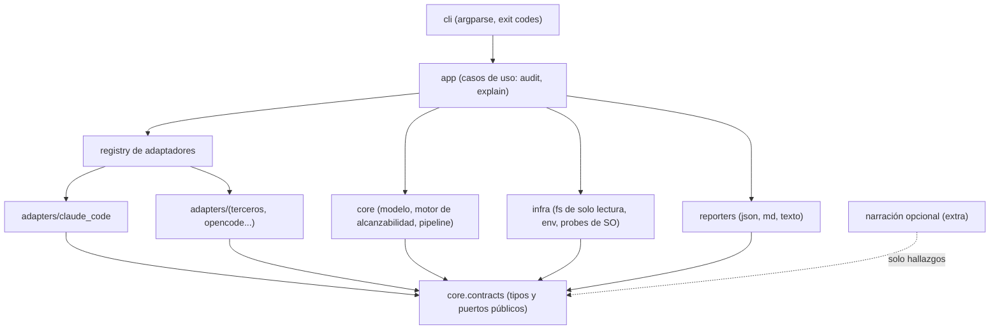
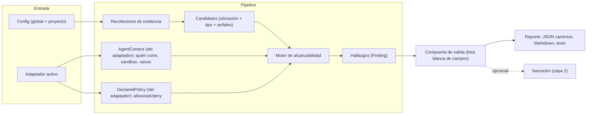

# AgentReach — Arquitectura del MVP (borrador)

> **Reemplazado el 2026-11-11** por `architecture-agent-reach-2026-11-11/ARCHITECTURE-SPINE.md`; este texto se conserva solo como historial.

> Es un borrador para que Alex lo discuta, no un veredicto. Convención de marcas:
> **[DECIDIDO]** lo fijó Alex (memory.md, brief o memlog del PRD).
> **[PROPUESTO]** lo propongo yo, con alternativas y trade-offs; Alex decide.
> **[SUPUESTO]** depende de algo no verificado; está listado al final.
>
> No se escribe código ni se define la API final. Se fijan solo las decisiones que, si cada quien las toma por su lado, harían derivar el proyecto.

## 1. Principios y restricciones

### 1.1 Ya decididos por Alex [DECIDIDO]

| # | Restricción | Fuente |
|---|---|---|
| D1 | Solo lectura: nunca modificar el repo ni el entorno analizado | memory.md, memlog |
| D2 | Ningún valor de secreto en ningún reporte: solo ubicación, tipo y nivel | memory.md |
| D3 | Sin red por defecto | memory.md |
| D4 | Niveles de alcanzabilidad: comprobado, potencial, hipótesis | brief, memlog |
| D5 | Dos ejes separados: alcanzabilidad (MVP) y actividad "observado" (Fase 2) | memlog |
| D6 | Definición de niveles en el MVP: comprobado = existe y los permisos reales del SO lo hacen legible (etapa 2); potencial = existe o hay referencia pero el acceso no se pudo verificar (etapa 1); hipótesis = inferencia indirecta | memlog |
| D7 | Una regla `deny` NO borra ni baja el hallazgo: se reporta con la nota "protegido por regla" | memlog |
| D8 | Dos capas: núcleo determinista (hallazgos estructurados) y narración opcional que solo recibe hallazgos; AgentReach no conversa con el usuario | memlog |
| D9 | Núcleo agnóstico + adaptadores que declaran capacidad (auditar / auditar y advertir / auditar y bloquear); primer adaptador Claude Code | memory.md |
| D10 | Instalación global y por proyecto | memory.md |
| D11 | Python + CLI + `uv`; Windows 11 (rutas, ACL, junctions) y POSIX | memory.md |
| D12 | Prevención (Fase 3) y observabilidad (Fase 2) deben poder añadirse sin reescribir el núcleo | brief |
| D13 | Un tercero puede añadir un adaptador sin tocar el núcleo | brief (criterio de éxito) |

Propuesta de Alex aún sin confirmar: ubicaciones sensibles del usuario (`~/.aws`, `~/.ssh`) opt-in, apagadas por defecto, solo metadatos. La arquitectura asume que se confirma (ver AD-9).

### 1.2 Principios de diseño derivados [PROPUESTO]

1. **Garantías por tipos y estructura, no por disciplina.** Las reglas D1-D3 se imponen con puertos que no ofrecen la operación prohibida, y con pruebas que fallan si se rompen. "Tener cuidado" no cuenta como control.
2. **Tecnología aburrida.** Biblioteca estándar primero (`dataclasses`, `json`, `tomllib`, `pathlib`, `argparse`). Cada dependencia de ejecución es superficie de ataque en una herramienta cuyo valor es la confianza.
3. **Determinismo.** Misma entrada, mismos hallazgos, mismo orden y mismos ids. Sin IA, sin aleatoriedad ni relojes dentro del núcleo. Hace posible el oráculo.
4. **Mostrar la evidencia, no la conclusión sola.** Un nivel sin evidencia estructurada es un defecto.
5. **Falla ruidosa y honesta.** Si no se pudo verificar algo, el hallazgo baja a "potencial" y lo dice. Nunca se asume alcanzable ni inalcanzable.

## 2. Paradigma y capas

**Hexagonal + pipeline.** El núcleo (dominio) define puertos; el mundo exterior (sistema de archivos, entorno, plataformas, formatos de salida) entra por adaptadores. Dentro, la auditoría es un pipeline de etapas puras: recolectar, clasificar, evaluar alcanzabilidad, ensamblar reporte.

Regla de dependencia (es una regla, no una sugerencia):



Lectura: `core` no importa `adapters`, `infra`, `reporters` ni `cli`. Los adaptadores solo importan `core.contracts`. Se verifica en CI con un linter de imports (`import-linter` o una prueba propia de grafo de imports).

## 3. Componentes

### 3.1 Vista general del flujo



### 3.2 Recolectores de evidencia

Cada recolector es un componente pequeño con un solo puerto: recibe un alcance y un `ReadOnlyFs`/`EnvView`, y devuelve `Candidate`s. No juzga alcanzabilidad.

| Recolector | Qué produce | Notas |
|---|---|---|
| Archivos del repo | Archivos con secretos probables (`.env`, claves privadas, tokens en configs), scripts de deploy | Recorrido con tope de tamaño y salto de binarios; no sigue enlaces fuera del alcance para leer contenido |
| Git (metadatos) | Credenciales en URLs de remotos, hooks, archivos ignorados que parecen secretos | Leer `.git/` como archivos; invocar el binario `git` es alternativa (ver AD-6) |
| Entorno | Nombres de variables con forma de credencial, y variables que apuntan a rutas/hosts | **Solo el nombre y la presencia**; el valor se evalúa en memoria si hace falta clasificar y se descarta |
| Archivos de contexto | `CLAUDE.md`, `AGENTS.md`, `README.md` con instrucciones sospechosas | Producen **hipótesis** por defecto (inferencia indirecta) |
| Ubicaciones del usuario (opt-in) | Existencia y permisos de `~/.ssh`, `~/.aws` | Apagado por defecto; nunca se abre un archivo ahí |
| Procesos y red | Ver decisión abierta Q5 | El brief los menciona; sin red por defecto implica solo análisis estático (URLs/hosts referenciados), no conexiones |

Los recolectores se registran por nombre; añadir uno no toca el motor.

### 3.3 Modelo de hallazgo (el contrato central)

Es el tipo más importante del sistema: todo lo demás (reporte, adaptadores, narración, Fase 2) depende de él. Se versiona (`schema_version`).

```text
Finding
  id            : hash estable de (tipo, ubicación normalizada)       # sin contenido
  location      : Location { kind: file|env|process|network|config,
                             path|name normalizado, scope: repo|home|system,
                             line (opcional, solo número) }
  type          : enum cerrado (private_key, api_token, cloud_credential,
                  env_credential, deploy_script, context_instruction, ...)
  reachability  : enum { comprobado, potencial, hipotesis }           # D4
  evidence      : [Evidence]                                          # ver abajo
  notes         : [Note]  # p. ej. protected_by_rule(rule_ref)        # D7
  mitigation    : código de catálogo (texto en el reporte, no libre)
  activity      : None  # reservado Fase 2: "observado" (D5), nunca se llena en MVP

Evidence (esquema CERRADO, sin campo de texto libre)
  kind  : enum { exists, mode_readable_by_agent_user, resolved_via_link,
                 referenced_from, env_name_present, declared_rule_matches,
                 sandbox_state, could_not_verify(reason_code) }
  data  : ints, enums, rutas normalizadas, ids de regla. Nunca cadenas arbitrarias.
```

Decisión de forma: el modelo no tiene dónde guardar un valor. No existe un campo `str` libre en `Finding` ni en `Evidence`. Es la primera línea de la garantía de la sección 4.

### 3.4 Motor de alcanzabilidad

Función pura: `evaluar(candidato, AgentContext, DeclaredPolicy, FsProbe) -> Finding`. Considera, en este orden:

1. **Resolución de ruta.** Cadena de symlinks/junctions/puntos de montaje, con límite de profundidad y detección de ciclos. La cadena completa queda como evidencia (`resolved_via_link`). Un enlace que sale del alcance declarado del agente no lo hace inalcanzable: lo hace alcanzable por un camino distinto, y se reporta así.
2. **Permiso del SO** para la identidad con que corre el agente (supuesto S1: el usuario). POSIX: modo/propietario/ACL. Windows: ACL y atributos (ver AD-5).
3. **Entorno:** variables que dan acceso (`AWS_PROFILE`, tokens), y variables que apuntan a algo no visible (origen típico de una hipótesis).
4. **Comandos disponibles:** si el uso de la credencial requiere un binario (`aws`, `gh`, `railway`) y está en `PATH`.
5. **Sandbox/límites** que declare el adaptador (`AgentContext`). Si el adaptador no puede saberlo, el motor lo registra como `could_not_verify` y no sube de "potencial".
6. **Superposición de política declarada.** Una regla `deny` aplicable añade la nota `protegido_por_regla`; no cambia el nivel (D7). Se explica en el reporte como política del agente, no barrera del SO.

Mapeo a niveles (D6), como tabla de decisión probada exhaustivamente:

| Existe | Permiso SO verificado como legible | Referencia o inferencia | Nivel |
|---|---|---|---|
| sí | sí | n/a | comprobado |
| sí | no se pudo verificar | n/a | potencial |
| sí | no legible | n/a | se reporta con evidencia de bloqueo; nivel por decidir (Q3) |
| no visible | n/a | sí (env, referencia) | hipótesis |

La tabla es el punto donde el producto y la arquitectura se tocan: cada celda ambigua es una decisión abierta, no un detalle de implementación.

### 3.5 Interfaz de adaptador y capacidad declarada [DECIDIDO el concepto; PROPUESTO la forma]

Un adaptador responde tres preguntas sobre su plataforma y declara una capacidad. No ve valores de secretos ni los busca.

```text
AgentAdapter (puerto)
  id, version
  capability        : enum ordenado { AUDITAR < AUDITAR_Y_ADVERTIR < AUDITAR_Y_BLOQUEAR }
  detect(project)   -> bool                        # ¿esta plataforma está presente?
  context(project)  -> AgentContext                # identidad/permisos, sandbox, raíces de trabajo,
                                                   #   o "desconocido" por campo
  declared_policy(project) -> DeclaredPolicy       # reglas allow/ask/deny, sandbox declarado,
                                                   #   ya normalizadas al modelo común
  # opcional, solo Fase 3:
  enforce(...)                                     # solo si capability == AUDITAR_Y_BLOQUEAR
```

Principios:

- **La capacidad debe poder demostrarse.** Un adaptador solo declara `AUDITAR_Y_ADVERTIR` si pasa el kit de conformidad (sección 8) con el comportamiento real de la plataforma. Hasta verificar los puntos de control de cada plataforma (investigación aparte, Q7 del brief), **todos los adaptadores del MVP declaran como máximo `AUDITAR_Y_ADVERTIR`, y la advertencia es del reporte/CLI**, no un hook dentro del agente [SUPUESTO S3].
- **Campos desconocidos son ciudadanos de primera clase.** `AgentContext` y `DeclaredPolicy` admiten `unknown` por campo. El motor trata `unknown` como "no se pudo verificar", lo que evita afirmar alcanzabilidad por desconocimiento (regla no negociable de memory.md).
- **Normalización.** Cada adaptador traduce sus reglas (ej. `allow/ask/deny` y bloque de sandbox de Claude Code en `settings.json`; `opencode.json` en opencode, según lo registrado en el memlog) al modelo común. Qué forma exacta, qué archivos y qué precedencia: **no verificado aquí** [SUPUESTO S2], depende de la investigación de puntos de control.
- **Los archivos de configuración del agente pueden contener secretos** (p. ej. variables de entorno en `settings.json`). Por eso el parser del adaptador también produce solo estructura (claves, reglas), y nunca vuelca el árbol crudo de la config a ningún objeto que llegue al reporte.
- **Narración (capa 2, D8).** Es un puerto separado, `Narrator`, que recibe `list[Finding]` ya filtrados por la compuerta y devuelve texto. No tiene acceso al sistema de archivos. Vive fuera del núcleo y fuera del MVP, salvo que Alex decida lo contrario.

### 3.6 Generación de reporte

- **Un solo formato canónico: JSON** con `schema_version`. Todo lo demás (Markdown, texto de terminal) se genera desde el JSON canónico, nunca desde objetos internos. Así los renderizadores no pueden ver nada que el JSON no tenga.
- **Compuerta de salida** (ver sección 4): único camino entre `Finding` y bytes de salida.
- Cabecera con: versión de AgentReach, versión de esquema, adaptador y capacidad declarada, alcance escaneado, qué recolectores estuvieron activos, y qué se **no** pudo verificar. Los timestamps van solo en la cabecera, nunca en los hallazgos (determinismo).
- Por defecto escribe a **stdout**. Escribir a archivo es opt-in y se rechaza si el destino cae dentro del árbol analizado (un reporte dentro del repo sería modificar el repo; ver AD-3).

## 4. Cómo se garantiza por diseño que un valor de secreto no llega a un reporte

El riesgo es que "ningún valor" dependa de que cada desarrollador recuerde no imprimirlo. El diseño apila cuatro barreras independientes; la primera es la que importa.

1. **Detectar sin retener (barrera primaria).** El detector es una función cerrada: recibe un flujo de bytes y devuelve solo `(tipo, número_de_línea | desplazamiento)`. Lee por bloques, mantiene el valor únicamente en variables locales de esa función, y no lo devuelve, no lo registra, no lo excepciona. Nada fuera del módulo del detector puede alcanzar el valor porque nunca sale.
2. **Tipos que no pueden transportar un valor.** `Finding` y `Evidence` usan enums, enteros y rutas normalizadas; no hay `str` libre (sección 3.3). Un cambio que añada un campo libre falla una prueba de esquema (el esquema debe permanecer cerrado y revisado).
3. **Compuerta de salida con lista blanca.** Los reportes se construyen serializando únicamente campos de una lista permitida, nunca con `asdict()` ni `repr()` genéricos. Además, `__repr__` de los tipos del detector está bloqueado, y los tracebacks no se imprimen con locales (`--debug` no habilita volcado de variables).
4. **Prueba canario (red de seguridad, no el control).** Cada secreto falso del repo de pruebas lleva un marcador único. La prueba ejecuta todo el pipeline y busca esos marcadores en todos los bytes producidos: stdout, stderr, JSON, Markdown, logs, mensajes de excepción y archivos temporales. Cualquier aparición falla el build.

Matiz importante sobre "huellas": se descarta incluir un hash del valor para deduplicar. Un hash de un secreto de baja entropía se puede revertir por fuerza bruta, y el id del hallazgo se calcula de (tipo, ubicación), no del contenido. Si Alex quiere detectar "el mismo secreto en dos sitios", la alternativa es una HMAC con clave aleatoria de proceso que solo sirve dentro de una misma ejecución y no se serializa (Q8).

Qué no cubre (límite honesto): el nombre de un archivo o de una variable de entorno puede, en casos raros, contener algo sensible; las rutas incluyen el nombre de usuario. Opción `--redact-paths` (reemplaza el directorio home por `~`) propuesta como valor por defecto en reportes compartibles.

### Alternativas para la barrera primaria

| Opción | Pros | Contras |
|---|---|---|
| A. Detectar sin retener + tipos cerrados (recomendada) | La garantía es estructural y verificable; barata; encaja con el modelo único de hallazgo | El detector se limita a lo que puede clasificar sin guardar; reglas de validación de formato (p. ej. checksum) viven dentro del detector |
| B. Retener el valor y luego depurar el reporte (redacción) | Más flexible (permite comparar, validar contra patrones después) | Un solo olvido filtra el secreto; la garantía depende de un filtro de salida, que siempre se rompe por el caso que no se previó |
| C. Retener en un almacén cifrado en memoria con acceso mediado | Permite dedup y re-validación | Complejidad desproporcionada para el MVP; amplía la superficie de ataque sin valor de usuario claro |

Recomendación: A, con la compuerta (barrera 3) y el canario (barrera 4) como defensa en profundidad. B queda descartada como primaria porque contradice D2 en la forma de fallar.

## 5. Instalación global y por proyecto

| Aspecto | Global (`uv tool install`) | Por proyecto |
|---|---|---|
| Qué es | La herramienta y preferencias del usuario | Política del repositorio, compartible con el equipo |
| Config | Directorio de configuración del usuario (en Windows: `%APPDATA%`; en POSIX: `$XDG_CONFIG_HOME`) | Archivo versionado en el repo (nombre propuesto: `.agentreach/policy.toml`) |
| Contenido | Adaptadores por defecto, formato de salida, opt-in de ubicaciones sensibles | Alcance, supresiones documentadas, adaptadores esperados, umbrales para CI |
| Precedencia | menor | mayor, con **excepciones de seguridad** abajo |

Reglas de seguridad de la configuración [PROPUESTO]:

- **El opt-in de ubicaciones sensibles (`~/.ssh`, `~/.aws`) solo puede activarse desde la config global del usuario o con un flag explícito en CLI.** Un `policy.toml` clonado de un repo ajeno no puede encenderlo. Razón: el archivo del repo es entrada no confiable; es el mismo problema que AgentReach audita.
- La config es **datos** (TOML vía `tomllib`), nunca código. Sin plantillas ni ejecución.
- Las **supresiones** (silenciar un hallazgo) están permitidas en config de proyecto, pero el reporte las muestra como "suprimido por política, motivo X" y no desaparecen. Coherente con D7.
- La política de proyecto no puede añadir recolectores ni adaptadores por ruta (solo seleccionar entre los instalados).

Alternativas para el archivo de proyecto:

| Opción | Pros | Contras |
|---|---|---|
| `.agentreach/policy.toml` (recomendada) | Espacio propio, crece con Fase 3 (políticas), fácil de ignorar o compartir | Un archivo más en el repo |
| `[tool.agentreach]` en `pyproject.toml` | Cero archivos nuevos, convención Python | Repos no Python no lo tienen; atado a un ecosistema, mal para una herramienta agnóstica |
| Archivo único en la raíz (`agentreach.toml`) | Visible | Ensucia la raíz; sin lugar natural para evidencias y supresiones |

Distribución: `uv tool install agentreach` (global) y `uvx agentreach audit` (sin instalar). Para el proyecto, `uv add --dev agentreach` es opcional; no se requiere que el repo auditado sea un proyecto Python.

## 6. Decisiones importantes (alternativas, trade-offs, recomendación)

Todas son [PROPUESTO] salvo donde se indica. Cada una tiene un id estable para el spine posterior.

### AD-1 — Forma del núcleo: hexagonal con modelo de hallazgo como contrato

| Opción | Pros | Contras |
|---|---|---|
| A. Hexagonal + pipeline (recomendada) | Cumple D12 y D13; el modelo de hallazgo es el punto estable; núcleo testeable sin SO real | Más indirección inicial que un script |
| B. Módulos por plataforma sin núcleo común | Rápido de arrancar | Contradice D9; cada adaptador reinventa hallazgos |
| C. Arquitectura de plugins con hooks por evento | Flexible | Prematura; el MVP no tiene eventos (son de Fase 2) |

### AD-2 — Registro de adaptadores: entry points

| Opción | Pros | Contras |
|---|---|---|
| A. Entry points de Python (`importlib.metadata`), adaptadores en paquetes (recomendada) | Un tercero publica un paquete sin tocar el núcleo (D13); estándar | Los adaptadores de terceros ejecutan código con permisos del usuario: hay que documentar el riesgo |
| B. Registro en el árbol (`adapters/` dentro del paquete) | Simple; sin riesgo de terceros | Cada adaptador exige un PR al núcleo; no cumple D13 |
| C. Carpeta de plugins por ruta configurable | Muy fácil de extender | Carga de código desde rutas arbitrarias: justo el vector que AgentReach debe vigilar |

Recomendación: B para el adaptador de referencia (Claude Code va en el árbol y sirve de plantilla) más A como mecanismo público, y el kit de conformidad como puerta de entrada. C descartada. La garantía D2 no depende de la honestidad del adaptador porque el adaptador nunca recibe valores: solo devuelve política y contexto estructurados.

### AD-3 — Cómo se impone "solo lectura"

| Opción | Pros | Contras |
|---|---|---|
| A. Puerto `ReadOnlyFs` (stat, listar, `open('rb')`, readlink) como único acceso, más prueba de árbol intacto y regla de lint (recomendada) | La operación de escribir no existe en la API del núcleo; verificable | No impide a un adaptador malicioso usar `open` directo (mitigable con lint y revisión) |
| B. Convención y revisión de código | Sin esfuerzo | No es verificable |
| C. Ejecutar en un proceso con permisos de solo lectura (sandbox propio) | Garantía del SO | En Windows nativo es poco práctico; sobreingeniería para el MVP |

Recomendación: A. Corolario: el reporte va a stdout por defecto; se rechaza `--output` dentro del árbol analizado. La prueba "hash y mtime del árbol antes y después" corre en CI sobre el repo de pruebas.

### AD-4 — "Sin red por defecto"

| Opción | Pros | Contras |
|---|---|---|
| A. Sin dependencias de red y prueba que bloquea sockets, más regla de imports en el núcleo (recomendada) | Verificable; la ausencia es estructural | No impide una dependencia transitiva futura (se cubre con la prueba) |
| B. Solo convención | Sencillo | No verificable |
| C. Permitir red con flag explícito para funciones como validar un secreto en vivo | Útil para validación | Es casi exactamente lo que el brief excluye; riesgo de confianza alto |

Recomendación: A. Cualquier función de red futura (p. ej. consultar bases de vulnerabilidades) sería un componente separado, apagado por defecto y marcado en la cabecera del reporte. Validar secretos contra servicios en vivo queda fuera del MVP.

### AD-5 — Cómo se evalúan permisos del SO (especialmente en Windows)

Es la decisión técnica más delicada: de ella depende que "comprobado" signifique algo (D6).

| Opción | Pros | Contras |
|---|---|---|
| A. Sondeo de apertura: intentar abrir en modo lectura y cerrar sin leer, para archivos del repo; metadatos sin abrir para ubicaciones sensibles (recomendada, con matiz) | Responde la pregunta real ("¿puede esta identidad abrirlo?") en ambos sistemas, incluidas ACL heredadas, grupos y junctions, con la API estándar | Abrir un archivo sensible es, estrictamente, un acceso (no se lee contenido, pero queda en auditorías del SO) |
| B. `os.access` | Sin abrir nada; estándar | En Windows no consulta ACL de forma fiable (el resultado puede inducir a error) [SUPUESTO S5] |
| C. Analizar ACL directamente (`icacls` por subproceso, o API de Windows vía `ctypes`/`pywin32`) | Permite explicar "por qué" con evidencia | Código específico de plataforma, difícil de probar, posible dependencia extra |

~~Recomendación original: A en el alcance del repo y solo metadatos en ubicaciones del usuario; C como mejora posterior.~~ **Reemplazada el 2026-11-06 (ver revisión).**

**Revisión 2026-11-06 (decisión de Alex + verificación).**
- Alex rechazó el sondeo de apertura: abrir un archivo para "comprobar" no es coherente con el compromiso de solo lectura. Además el sondeo mide los permisos **de AgentReach**, no los **del agente** (que puede tener otro usuario, reglas `deny` o límites propios), así que respondía una pregunta distinta.
- La verificación confirma que `os.access` en Windows no consulta ACL (solo atributos; `verificacion-pendientes.md`, S5), así que B queda descartada con fuente.
- **Nueva recomendación: C como camino principal.** El alcance se calcula desde los **permisos del archivo (ACL en Windows, modo/propietario/ACL en POSIX) más las reglas del agente**, sin abrir el archivo. "Comprobado" exige los tres hechos: el archivo existe, el permiso efectivo permite leer a la identidad del agente, y ninguna regla del agente lo bloquea. Si algún hecho no puede determinarse con certeza, el hallazgo baja a "potencial".
- El hallazgo debe listar esos hechos como evidencia, con la ruta exacta, la regla con archivo y línea, y un comando que el usuario pueda ejecutar para repetirlo.
- **Abierto:** cómo implementar C en Windows (API vía `ctypes` o subproceso `icacls`; Python solo usa `GetFileAttributesW` en `os.access`) y su fiabilidad con herencia y grupos. Se valida contra el oráculo; si falla, "comprobado" en Windows se reconsidera.
- Mantener `FsProbe` como puerto, ahora con una operación "permiso efectivo" en lugar de "abrir".

Las pruebas con junctions de Windows requieren `mklink /J`; asumo que se pueden crear sin privilegios de administrador (a diferencia de los symlinks) [SUPUESTO S6]; si no es así, se marcan como pruebas condicionadas al entorno.

### AD-6 — Lectura de Git

| Opción | Pros | Contras |
|---|---|---|
| A. Leer `.git/` como archivos (config, hooks, ignore) (recomendada) | Sin subprocesos; coherente con `ReadOnlyFs`; no depende de que `git` exista | Cubre menos que `git` (packed refs, worktrees: se documenta el límite) |
| B. Invocar `git` por subproceso | Respuestas completas | Subproceso fuera del puerto de solo lectura; algunos comandos escriben (índice); superficie de riesgo. Una carpeta con su propio `.git` puede traer `core.fsmonitor`, un filtro o un hook que ejecuta un programa en cuanto se consulta git |

**Decisión (2026-11-09): A, firme en el MVP.** AgentReach **no ejecuta ningún programa externo** en el MVP (ni `git`, ni `icacls`, ni otro). Git se lee como **texto** (`.git/config`, `.gitmodules`, `.gitattributes`, nombres de `.git/hooks/`) con un lector propio fiel a git; si el texto no se puede interpretar, no se ejecuta nada y se reporta "no se pudo revisar" (TH-20, falla cerrado). Lo que exige git (historial de commits, caso GT-02; archivos rastreados, GT-01) sale como "no se pudo revisar" o "no determinado". **Ejecutar git con defensas es fase 2**: entorno limpio, ruta absoluta del binario, lista cerrada de comandos de solo lectura, sin `status`, `diff`, `add` ni `checkout`, en un puerto aparte. El caso TR-01 del oráculo (`trampas/PWNED.txt` no debe existir) y la prueba de reemplazar `subprocess`, `os.system`, `os.popen`, `os.startfile`, `os.exec*` y `os.spawn*` por funciones que fallan vigilan esta decisión.

### AD-7 — Modelo de datos y dependencias

| Opción | Pros | Contras |
|---|---|---|
| A. `dataclasses` congeladas + JSON Schema generado y comprobado en pruebas (recomendada) | Cero dependencias; el esquema cerrado es verificable | Menos validación automática al leer |
| B. Pydantic | Validación y esquema gratis | Dependencia grande en una herramienta de confianza; tentación de campos libres |
| C. `TypedDict` | Ligero | Sin inmutabilidad ni garantías en tiempo de ejecución |

Recomendación: A. Python mínimo supuesto: 3.11 por `tomllib` [SUPUESTO S7].

### AD-8 — Formatos de reporte

| Opción | Pros | Contras |
|---|---|---|
| A. JSON canónico + Markdown + texto de terminal (recomendada) | Cubre humanos y máquinas; JSON versionado sirve a Fase 2 | Tres salidas que mantener (Markdown y texto derivan del JSON) |
| B. Además SARIF | Se integra con GitHub Code Scanning y otras herramientas | Su modelo de "resultado" fuerza ubicaciones de código y puede empujar a incluir fragmentos de contenido; se pospone |
| C. Solo texto | Mínimo | No automatizable ni comparable con el oráculo |

Recomendación: A; B como adaptador de reporte posterior, con la misma compuerta.

### AD-9 — Ubicaciones sensibles del usuario

La propuesta de Alex (opt-in, apagadas, solo metadatos) se adopta como base [PENDIENTE de confirmación]. Mi aporte: la regla de que solo la config global o un flag en CLI pueden encenderlo (sección 5), y que la evidencia en estas ubicaciones sea de tipo `exists` y `mode_*`, nunca `content_*`. Sin esas ubicaciones, la etapa 2 sobre credenciales de usuario nunca llega a "comprobado" para el usuario: el reporte debe decirlo ("no evaluado: ubicación sensible desactivada").

### AD-10 — Capas de narración

Se mantiene D8. Propuesta de forma: el puerto `Narrator` existe como interfaz vacía en `core.contracts` para no tener que rediseñarlo, pero no hay implementación en el MVP. Costo: una interfaz sin usar. Beneficio: la frontera de datos (solo `Finding`, nunca archivos) queda escrita antes de que alguien conecte un modelo de lenguaje.

## 7. Estructura de carpetas propuesta del paquete

```text
AgentReach/
  pyproject.toml                # uv; script de consola `agentreach`
  src/agentreach/
    contracts/                  # tipos y puertos públicos (estable, versionado)
      finding.py                #   Finding, Location, Evidence, Note, enums
      ports.py                  #   ReadOnlyFs, EnvView, FsProbe, AgentAdapter, Narrator
      schema/finding.schema.json
    core/                       # dominio puro; sin E/S directa
      pipeline.py
      reachability.py           #   motor + tabla de decisión
      taxonomy.py               #   tipos de hallazgo, catálogo de mitigaciones
    collectors/                 # cada uno devuelve Candidate
      repo_files.py  git_meta.py  environment.py  context_files.py  user_locations.py
      detector/                 #   detectar sin retener (módulo aislado y pequeño)
    infra/                      # implementaciones de puertos
      fs_readonly.py  env_view.py
      probe_windows.py  probe_posix.py
    adapters/
      claude_code/              # adaptador de referencia (en el árbol)
      conformance/              #   kit de conformidad reutilizable por terceros
    reporting/
      gate.py                   #   compuerta de salida con lista blanca
      json_report.py  markdown_report.py  text_report.py
    config/                     # carga TOML global + proyecto, reglas de precedencia
    app/                        # casos de uso: audit, list-adapters
    cli/                        # argparse, códigos de salida
  tests/
    unit/  contract/  e2e/  property/
    oracle/                     # checklist y expected.json (oráculo)
    fixtures/
      leaky_repo_template/      # plantillas; los secretos falsos se generan al ejecutar
  docs/                         # cómo escribir un adaptador, modelo de amenazas
```

Notas: `contracts/` es lo único que importan los adaptadores y lo que cambia con más cuidado (versionado semántico). Los secretos falsos se **generan en pruebas desde plantillas** y no se versionan, para no activar la protección de secretos de GitHub ni escáneres de terceros sobre el propio repo.

## 8. Estrategia de pruebas

Ligada al plan de Alex: checklist, auditoría manual (oráculo), automatización, comparación, y repo con secretos falsos si hace falta.

| Capa | Qué prueba | Cómo |
|---|---|---|
| Unitarias | Tabla de decisión de alcanzabilidad (cada fila y celda ambigua), normalización de rutas, taxonomía | Tablas de casos; sin SO real, con `FsProbe` falso |
| Propiedades | La compuerta no emite campos fuera de la lista blanca; el esquema permanece cerrado | Pruebas basadas en propiedades sobre `Finding` generados |
| Contrato de adaptador | Un adaptador cumple el puerto y su capacidad declarada es verificable | Kit de conformidad (`adapters/conformance`), mismo para Claude Code y para terceros |
| Oráculo | Los hallazgos del núcleo coinciden con la auditoría manual | La checklist se convierte en `expected.json` (ubicación, tipo, nivel esperado). Reporte de coincidencias, faltantes (falsos negativos) y sobrantes (falsos positivos). Primero repos propios en solo lectura; luego el repo falso |
| Repo de secretos falsos | Casos conocidos y trampas | Ver abajo; se genera al ejecutar |
| Canario (seguridad) | Ningún valor llega a ninguna salida | Marcador único por secreto falso; buscado en stdout, stderr, JSON, Markdown, logs, excepciones, temporales |
| Solo lectura | El árbol no cambia | Hash y mtime antes/después de cada ejecución e2e |
| Sin red | No hay sockets | Fixture que bloquea `socket` en todas las pruebas |
| Matriz de CI | Windows y POSIX | `windows-latest` y `ubuntu-latest`; pruebas de junction/ACL marcadas por plataforma |

**Repo de secretos falsos: trampas mínimas para cubrir.**
Secreto legible con permisos normales (comprobado); secreto ilegible por permisos (bloqueo con evidencia); symlink hacia fuera del alcance; junction (Windows); ciclo de enlaces; `.env.example` y claves de documentación (falsos positivos esperados: su tratamiento es la Q4); archivo de contexto con instrucción sospechosa (hipótesis); variable de entorno que apunta a algo no visible (hipótesis); regla `deny` que cubre un secreto (hallazgo con nota "protegido por regla", D7); archivo binario grande; nombre de archivo con caracteres especiales.

**Criterio de éxito de pruebas ligado al brief:** el canario y la prueba de árbol intacto son bloqueantes; las coincidencias contra el oráculo son una métrica con umbral por definir (Q6), no un pase/falla en el MVP.

## 9. Fases futuras sin reescribir el núcleo [DECIDIDO como objetivo]

| Fase | Qué se añade | Dónde entra | Qué ya está reservado |
|---|---|---|---|
| 2 Observabilidad | Registros del agente (etapas 3-4), historial | Nuevo recolector de "actividad" y un adaptador que lea los registros de la plataforma | `Finding.activity` (eje separado, D5); `schema_version` |
| 3 Protección | Políticas y bloqueo | Método `enforce` del adaptador, solo si `AUDITAR_Y_BLOQUEAR` | `capability` en el adaptador; `declared_policy` ya normalizada |

Advertencia: la Fase 2 introduce datos que pueden contener valores de secretos (comandos y salidas del agente). Su garantía D2 no se hereda gratis del MVP: exigirá su propia versión de "detectar sin retener" sobre registros.

## 10. Decisiones abiertas para Alex

1. **Q1 — Confirmar las ubicaciones sensibles opt-in** (`~/.ssh`, `~/.aws`, solo metadatos) y mi regla de que solo la config global o un flag las enciende, no la política del repo.
2. **Q2 — RESUELTA el 2026-11-06 por Alex: no se abre el archivo; el alcance se calcula desde ACL/metadatos y reglas del agente (ver revisión de AD-5). Queda abierta solo la implementación en Windows.** Texto original: Sondeo de apertura vs `os.access`/ACL (AD-5). ¿Aceptas que AgentReach abra (sin leer) archivos del repo para "comprobar", sabiendo que queda como acceso en auditorías del SO? ¿Y aceptas una dependencia o subproceso (`icacls`) para explicar ACL en Windows, o prefieres cero dependencias y menos explicaciones?
3. **Q3 — Archivo existente pero NO legible para el usuario del agente:** ¿qué nivel y qué texto? (No es "comprobado"; ¿se reporta como hallazgo con evidencia de bloqueo, igual que el caso deny?) Es la celda ambigua de la tabla 3.4.
4. **Q4 — Falsos positivos y secretos de ejemplo:** `.env.example`, claves de documentación. ¿Se reportan con nota, se omiten o hay lista de supresión por proyecto? (Propongo: se reportan con nota y supresión visible en el reporte.)
5. **Q5 — Procesos y accesos de red en el MVP:** el brief los lista. Con "sin red" y solo lectura, ¿basta el análisis estático (hosts/URLs referenciados, scripts) y se difiere la enumeración de procesos? Enumerar procesos suele pedir una dependencia (`psutil`) o subprocesos.
6. **Q6 — Umbral del oráculo:** ¿qué coincidencia mínima contra la auditoría manual hace "aceptable" el MVP (y cómo tratamos falsos positivos frente a falsos negativos)? Y puntaje AES: ¿se mantiene en el MVP o se difiere?
7. **Q7 — Capacidad que puede declarar el adaptador de Claude Code en el MVP.** Propongo "auditar y advertir" con advertencia en reporte/CLI. Depende de la investigación de puntos de control.
8. **Q8 — ¿Se necesita detectar "el mismo secreto en dos sitios"?** Implica un identificador efímero por ejecución (HMAC con clave aleatoria); sin él, se descarta la dedup por contenido.
9. **Q9 — Segundo adaptador (opencode, que Alex usa en otro PC):** ¿se construye en el MVP para probar la neutralidad del núcleo, o solo después? Costo: una segunda forma de normalizar `allow/ask/deny` desde el inicio; beneficio: valida D13 antes de publicarlo.
10. **Q10 — Narración:** ¿se deja solo el puerto vacío (AD-10) o se difiere por completo?
11. **Q11 — Nombre y lugar del archivo de política del proyecto** (`.agentreach/policy.toml` propuesto) y política de supresiones.
12. **Q12 — Reportes compartibles:** ¿`--redact-paths` activado por defecto? Las rutas llevan el nombre de usuario.

## 11. Supuestos (a verificar)

| # | Supuesto | Por qué importa | Cómo se verifica |
|---|---|---|---|
| S1 | El agente corre con los permisos del usuario que lo lanza (en Windows nativo, sin sandbox) | Sostiene que "comprobado" en etapa 2 es viable. El memlog lo registra como sostenido para el caso de Alex | **CONFIRMADO con fuente primaria (2026-11-06)**: sin sandbox en Windows nativo, y el entorno heredado incluye secretos (`verificacion-pendientes.md`); aún conviene probarlo en la máquina de Alex |
| S2 | La forma exacta de las reglas y la precedencia de configuración de Claude Code y opencode (archivos, ubicaciones, qué gana) | Define la normalización del adaptador | **CONFIRMADO con fuente primaria (2026-11-06)**: rutas y precedencia de Claude Code y de opencode en Windows (`verificacion-pendientes.md`); faltan las rutas de skills gestionados y la versión de opencode de Alex |
| S3 | Ni Claude Code ni opencode ofrecen aquí un punto de control del que AgentReach dependa para bloquear en el MVP | Fija la capacidad máxima del adaptador en `AUDITAR_Y_ADVERTIR` | Investigación en curso |
| S4 | Un `deny` de lectura en opencode no se aplica a lo que ejecuta el shell | Justifica que `deny` no baje el nivel (D7) | **VERIFICADO (2026-11-06)** para opencode 2.x en código e issues oficiales (`verificacion-pendientes.md`); opencode tiene líneas 1.x y 2.x que su documentación mezcla |
| S5 | `os.access` no es fiable para ACL en Windows | Descarta la opción B de AD-5 | **VERIFICADO (2026-11-06)**: en CPython 3.13 solo llama a `GetFileAttributesW` |
| S6 | Las junctions se crean sin administrador en Windows 11 | Permite pruebas de junction en CI y local | **VERIFICADO en el equipo de Alex (2026-11-06)**: `mklink /J` creó una junction real sin administrador (proceso no elevado). El enlace simbólico sí falló sin privilegio (WinError 1314), así que las pruebas de enlace simbólico son condicionales |
| S7 | Python mínimo 3.11 (`tomllib`) y `uv` disponible | Evita dependencia para leer TOML | Decisión de versión mínima |
| S8 | El nombre de las variables de entorno y los metadatos de ruta son seguros de incluir en un reporte | Si no, hay que sumar redacción | Revisión con el modelo de amenazas |
| S9 | Cualquier archivo `settings.json`/`opencode.json` puede contener valores sensibles (env, tokens de MCP) | Obliga a que el parser del adaptador descarte valores | Revisar archivos de ejemplo sin credenciales reales |
| S10 | Las plataformas de CI con Windows permiten probar ACL y junctions de forma representativa | Cobertura de D11 | Primer pipeline |

## 12. Fuera de este borrador

Modelo de amenazas formal (propongo un `docs/threat-model.md` que parta de AD-2 y de la garantía de la sección 4); contrato exacto de la API de adaptador; formato final del esquema JSON; y el spine de arquitectura completo según `bmad-architecture`, que conviene generar cuando Alex responda Q1-Q7.
